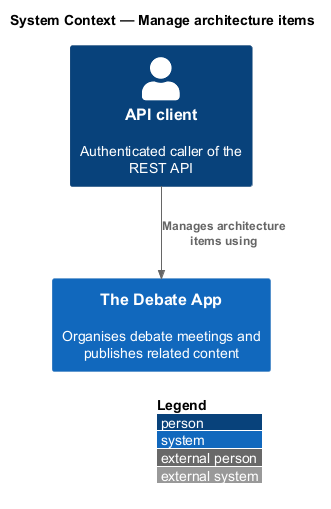
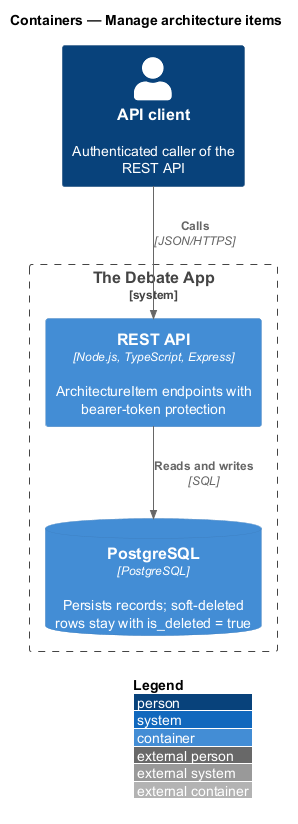
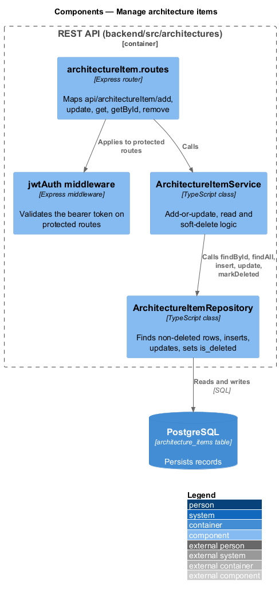
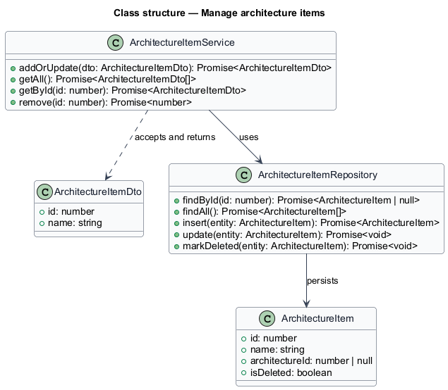
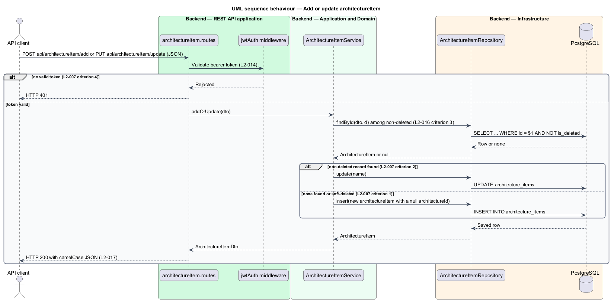
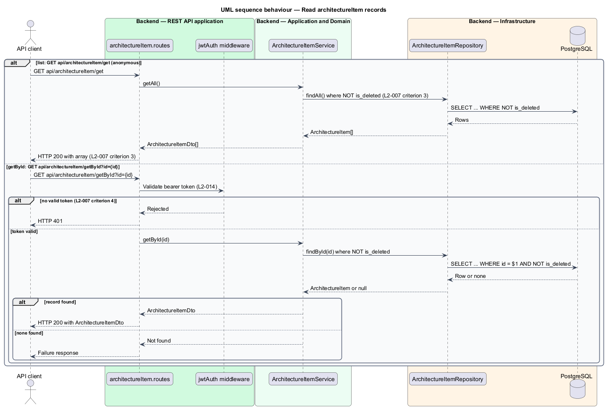
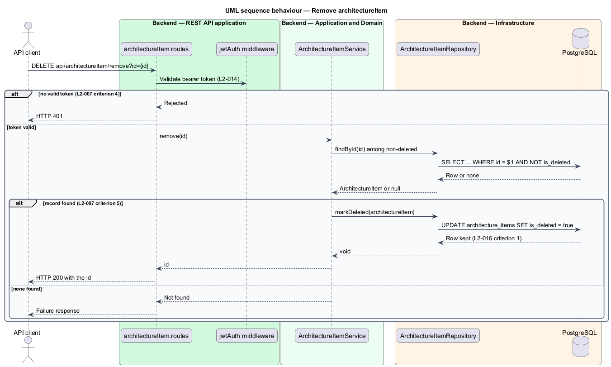

# Manage architecture items

## Overview

The Debate App publishes content next to its meetings. An *architecture item* is a named element that is intended to belong to an architecture. This feature creates, updates, lists, retrieves and soft-deletes architecture items through the REST API.

**add-or-update** — single operation that creates a record when no non-deleted record matches the supplied `id` and overwrites the matching record otherwise

The Angular client has no screen for this resource: article, architecture and user interfaces are listed under "Not Implemented" in `docs/specs/L1.md` and are out of scope in `AGENTS.md`. The feature is API only, and `docs/mocks` contains no page, dialog or notification for it. A client service in `projects/api` is optional and is `<TO SUPPLY>`.

## Description

The slice runs from the Express router to the `architecture_items` table.

- **`architectureItem.routes`** — Express router in `backend/src/architectures`, mounted at `api/architectureItem`, with the routes `add`, `update`, `get`, `getById` and `remove`.
- **`jwtAuth` middleware** — applied to every route except `get`.
- **`ArchitectureItemService`** — application service. `addOrUpdate` finds the non-deleted item by `id`, then overwrites `name` or inserts a new record with a null `architecture_id`.
- **`ArchitectureItemRepository`** — data access that filters on `is_deleted = false`.
- **`ArchitectureItemDto`** — `id` and `name` only.

The `architecture_id` column is nullable, references `architectures`, and is never set through the API (L2-007). How an item becomes attached to an architecture is `<TO SUPPLY>`.

**Authentication.** `get` is anonymous. `add`, `update`, `getById` and `remove` require a valid bearer token, validated by the JWT middleware of the auth subsystem (L2-014). A request without a valid token receives HTTP 401.

**Missing record.** For `getById` and `remove`, an unknown or soft-deleted `id` makes the request fail. The status code of the new API for that case is `<TO SUPPLY>`.

Constraints on `name` are `<TO SUPPLY>`.

| Operation | Method and route | Auth | Result |
|-----------|------------------|------|--------|
| Add | `POST api/architectureItem/add` | bearer | HTTP 200 `{ id, name }` |
| Update | `PUT api/architectureItem/update` | bearer | HTTP 200 `{ id, name }` |
| List | `GET api/architectureItem/get` | anonymous | HTTP 200 array of `{ id, name }` |
| Get | `GET api/architectureItem/getById?id={id}` | bearer | HTTP 200 `{ id, name }` |
| Remove | `DELETE api/architectureItem/remove?id={id}` | bearer | HTTP 200 `id` |

## Requirements

| L2 ID | Refines (L1) | Requirement |
|-------|--------------|-------------|
| `L2-007` | `L1-003` | `ArchitectureItemController` routes at `api/architectureItem` shall be `add`, `update`, `get` (anonymous), `getById` and `remove`, and the DTO shall expose `id` and `name`. With a valid bearer token, `POST api/architectureItem/add` with `{ id: 0, name }` shall create an item with that `name` and a null `ArchitectureId` and return `{ id, name }`, `PUT api/architectureItem/update` shall overwrite its `name`, and `DELETE api/architectureItem/remove?id={id}` shall set `IsDeleted` and return the `id`. Without credentials, `GET api/architectureItem/get` shall return all non-deleted items as `{ id, name }`, and every other architecture item action shall return HTTP 401. |
| `L2-014` | `L1-006` | A request to a protected endpoint carrying `Authorization: Bearer {valid token}` shall be authorized. A request without an `Authorization` header, or with an expired, wrong-audience, wrong-issuer or invalid-signature token, shall receive HTTP 401. |
| `L2-016` | `L1-007` | A record removed through its `remove` action shall remain in the database with `IsDeleted = true`. A record with `IsDeleted = true` shall be excluded from `get` and `getById`, and an add-or-update request carrying its `id` shall insert a new record. |
| `L2-017` | `L1-008` | The system shall return JSON with camelCase property names for every API response. |

## Diagrams

### System context

An authenticated API client manages architecture items through The Debate App. No user interface exists for this resource (see Overview).

### Containers

The API client calls the REST API directly, and the REST API reads and writes PostgreSQL. No web client container takes part.

### Components

The router applies the token middleware to protected routes and calls `ArchitectureItemService`, which uses `ArchitectureItemRepository`.

### Class structure

`ArchitectureItemService` maps between `ArchitectureItemDto` and the `ArchitectureItem` entity, which carries `isDeleted`.

### Behaviour — add or update

A valid token is required. The service updates a non-deleted match or inserts a new record (L2-007).

### Behaviour — read

The list is anonymous. `getById` requires a valid token (L2-007).

### Behaviour — remove

A valid token is required. The service sets the soft-delete flag (L2-007).

