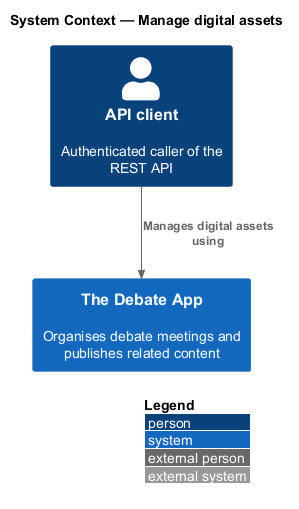
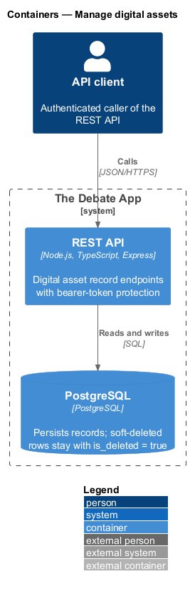
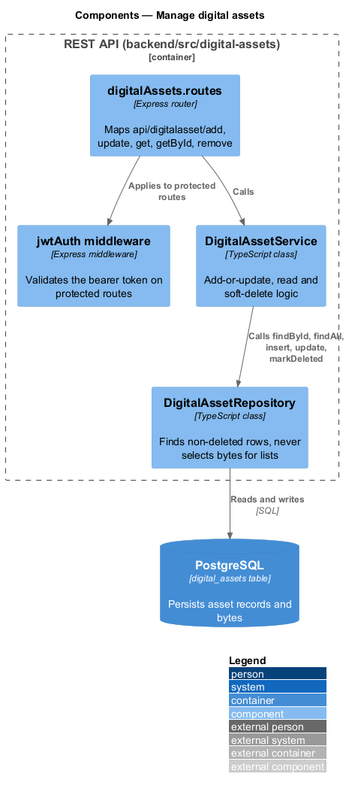
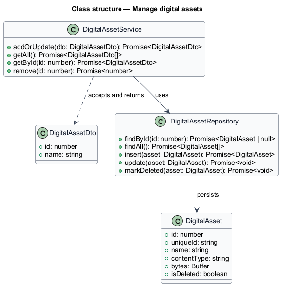
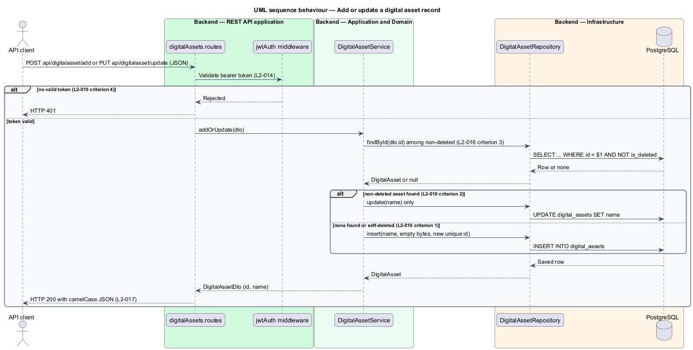
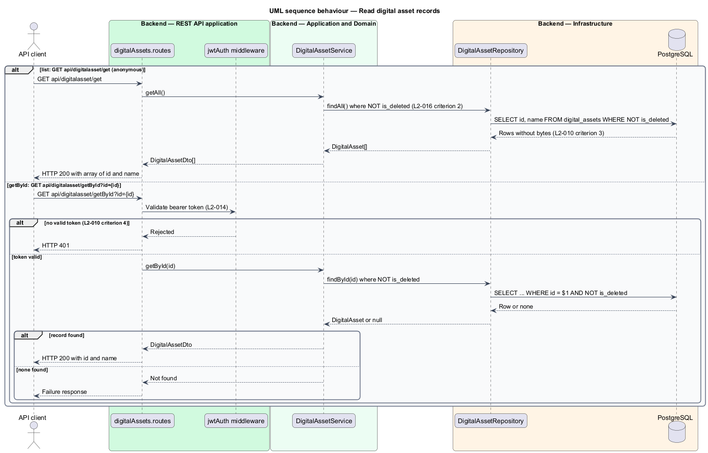
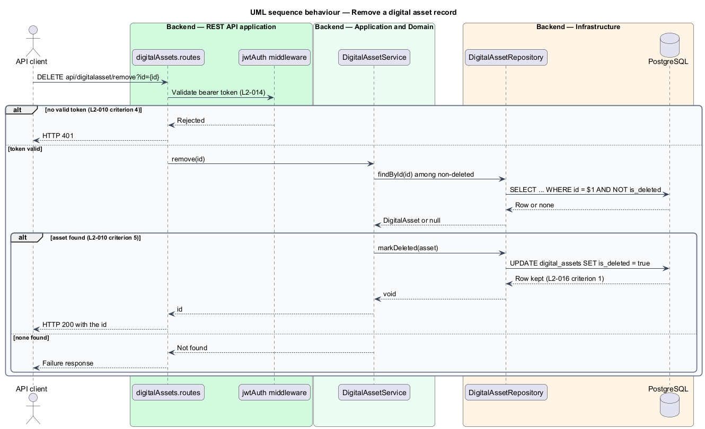

# Manage digital assets

## Overview

The Debate App stores uploaded files in its database. A *digital asset* is a stored file with a name, a content type, its bytes and a unique identifier. This feature manages the asset records through the REST API: create, rename, list, retrieve and soft-delete.

**unique id** — GUID assigned to an asset at creation and used to serve its bytes (`digital-assets/serve-digital-asset`)

The record operations expose only `id` and `name`. The bytes arrive through the upload endpoint (`digital-assets/upload-digital-asset`) and leave through the serve endpoint (`digital-assets/serve-digital-asset`). The list never includes the bytes, so a listing stays small.

The Angular client has no asset management screen. The mocks defer the one asset-related interaction, the insert-image dialog of the rich-text editor (`docs/mocks/README.md`, question 3), so no UI is designed here.

## Description

The slice runs from the Express router to the `digital_assets` table.

- **`digitalAssets.routes`** — Express router in `backend/src/digital-assets`, mounted at `api/digitalasset`, with `add`, `update`, `get`, `getById` and `remove`. The `get`, `upload` and `serve` routes are anonymous.
- **`jwtAuth` middleware** — applied to `add`, `update`, `getById` and `remove`.
- **`DigitalAssetService`** — application service. `addOrUpdate` overwrites only `name` on a match. On insert it stores an empty byte array and a fresh `unique_id`.
- **`DigitalAssetRepository`** — data access. Record lookups filter on `is_deleted = false`, and list queries select `id` and `name` without `bytes`.
- **`DigitalAssetDto`** — `id` and `name` only.
- **`digital_assets`** table — `id`, `unique_id` (uuid, unique), `name`, `content_type`, `bytes` (bytea) and `is_deleted`. The exact column set and the relation between `name` and the uploaded file name are `<TO SUPPLY>`.

**Authentication.** Requests without a valid token to `add`, `update`, `getById` and `remove` receive HTTP 401. The list is anonymous (L2-010 criteria 3 and 4).

**Missing record.** For `getById` and `remove`, an unknown or soft-deleted `id` makes the request fail. The status code is `<TO SUPPLY>`.

| Operation | Method and route | Auth | Result |
|-----------|------------------|------|--------|
| Add | `POST api/digitalasset/add` | bearer | HTTP 200 `{ id, name }` |
| Update | `PUT api/digitalasset/update` | bearer | HTTP 200 `{ id, name }` |
| List | `GET api/digitalasset/get` | anonymous | HTTP 200 array of `{ id, name }`, no bytes |
| Get | `GET api/digitalasset/getById?id={id}` | bearer | HTTP 200 `{ id, name }` |
| Remove | `DELETE api/digitalasset/remove?id={id}` | bearer | HTTP 200 `id` |

## Requirements

| L2 ID | Refines (L1) | Requirement |
|-------|--------------|-------------|
| `L2-010` | `L1-005` | `DigitalAssetController` routes at `api/digitalasset` shall be `add`, `update`, `get` (anonymous), `getById` and `remove`, and the DTO shall expose `id` and `name` only. With a valid bearer token, `POST api/digitalasset/add` with `{ id: 0, name }` shall create a record with that `Name`, an empty byte array and a fresh `UniqueId` and return `{ id, name }`, `PUT api/digitalasset/update` shall overwrite only `Name`, and `DELETE api/digitalasset/remove?id={id}` shall set `IsDeleted` and return the `id`. Without credentials, `GET api/digitalasset/get` shall return all non-deleted assets as `{ id, name }` without `bytes`, and `getById`, `add`, `update` and `remove` shall return HTTP 401. |
| `L2-014` | `L1-006` | A request to a protected endpoint carrying `Authorization: Bearer {valid token}` shall be authorized. A request without an `Authorization` header, or with an expired, wrong-audience, wrong-issuer or invalid-signature token, shall receive HTTP 401. |
| `L2-016` | `L1-007` | A record removed through its `remove` action shall remain in the database with `IsDeleted = true`. A record with `IsDeleted = true` shall be excluded from `get` and `getById`, and an add-or-update request carrying its `id` shall insert a new record. |
| `L2-017` | `L1-008` | The system shall return JSON with camelCase property names for every API response. |

## Diagrams

### System context

An authenticated API client manages asset records through The Debate App. No user interface exists for this operation.

### Containers

The API client calls the REST API, which reads and writes PostgreSQL.

### Components

The router applies the token middleware and calls `DigitalAssetService`, which uses `DigitalAssetRepository`.

### Class structure

`DigitalAssetDto` carries `id` and `name`. The `DigitalAsset` entity also holds the bytes, the content type and the unique id.

### Behaviour — add or update

Only `name` is written on update. Insert creates an empty asset with a fresh unique id (L2-010).

### Behaviour — read

The list is anonymous and omits bytes. `getById` requires a valid token (L2-010).

### Behaviour — remove

A valid token is required. The service sets the soft-delete flag (L2-010).

