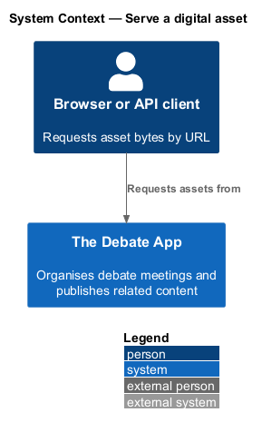
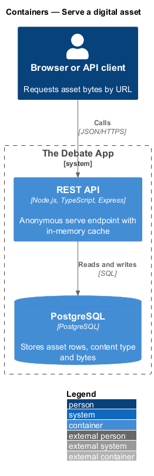
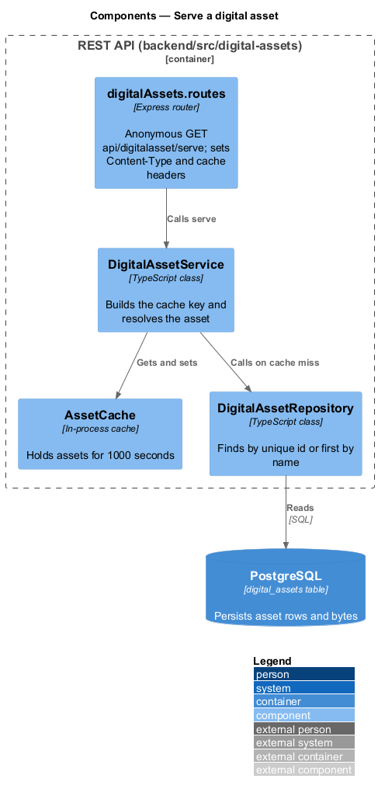
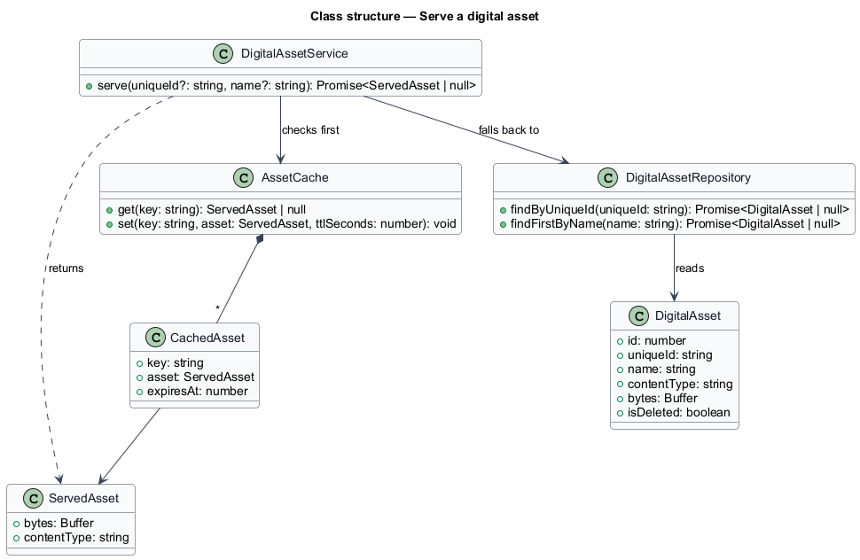
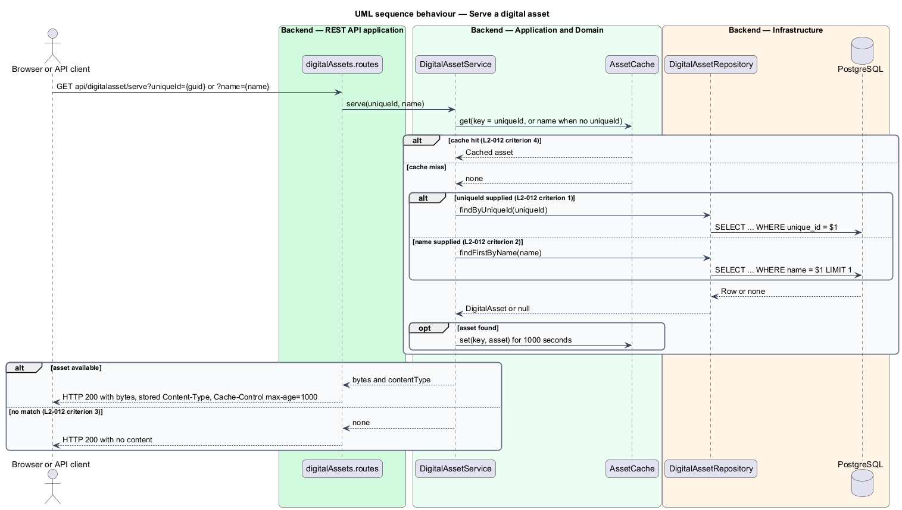

# Serve a digital asset

## Overview

The Debate App stores uploaded files in its database. A *digital asset* is a stored file with a name, a content type, its bytes and a unique identifier. This feature returns the stored bytes of an asset with its original content type, so a browser can render an image or download a file directly from a URL.

**asset cache** — in-memory store of recently served assets keyed by the lookup value, so repeated requests skip the database

The endpoint is anonymous and accepts either the `uniqueId` of the asset or its `name`. A lookup by `uniqueId` is exact. A lookup by `name` returns the first match. Content in the rich-text editor, such as an inserted image, refers to an asset by this URL.

## Description

The slice runs from the Express router to the `digital_assets` table, with an in-process cache between them.

- **`digitalAssets.routes`** — Express router. `GET api/digitalasset/serve` is anonymous. The handler reads the `uniqueId` and `name` query parameters, sets `Content-Type` from the stored value and writes the bytes. `uniqueId` takes precedence over `name`.
- **`DigitalAssetService.serve`** — application service. It builds the cache key (the `uniqueId` string, or the `name` when no `uniqueId` is supplied), consults `AssetCache`, and falls back to the repository.
- **`AssetCache`** — in-process store, for example a `Map` with expiry timestamps. Entries expire after 1000 seconds. Its maximum size and eviction policy are `<TO SUPPLY>`.
- **`DigitalAssetRepository`** — `findByUniqueId` and `findFirstByName`.

**HTTP caching.** The response advertises a client lifetime and a server lifetime of 1000 seconds (L2-012 criterion 4). The design maps this to `Cache-Control: public, max-age=1000, s-maxage=1000`. Whether the response also carries an `ETag` is `<TO SUPPLY>`.

**No match.** When neither parameter matches an asset, the response is HTTP 200 with no content (L2-012 criterion 3). Whether the new API answers HTTP 404 instead is `<TO SUPPLY>`.

**Soft-deleted assets.** The legacy lookup does not filter on `IsDeleted`, so a soft-deleted asset is still served (L2-012 criterion 5). That behaviour conflicts with L1-007, which excludes deleted records from reads. Content that refers to an asset by URL may rely on the legacy behaviour. The decision to retain or remove it is `<TO SUPPLY>`. The requirement as written shall be implemented until the decision is made.

**Cache staleness.** Entries are keyed by lookup value and held for 1000 seconds, so a rename or removal is not visible to a cached key until the entry expires. Invalidation on update or removal is `<TO SUPPLY>`.

**Name collisions.** Several assets may share a `name`. The first match is returned, and the ordering that defines "first" is `<TO SUPPLY>`.

| Request | Response |
|---------|----------|
| `?uniqueId={guid}` matches | HTTP 200, stored bytes, stored `Content-Type` |
| No `uniqueId`, `?name={name}` matches | HTTP 200, bytes of the first matching asset |
| No match | HTTP 200, no content |
| Repeat of an earlier key within 1000 seconds | Served from `AssetCache`, no database query |

## Requirements

| L2 ID | Refines (L1) | Requirement |
|-------|--------------|-------------|
| `L2-012` | `L1-005` | `GET api/digitalasset/serve?uniqueId={guid}` or `?name={name}` shall be anonymous, cached, and shall return raw bytes. A matching `uniqueId` shall return HTTP 200 with the asset's `Bytes` as the body and `Content-Type` equal to the stored `ContentType`. With no `uniqueId`, a `name` matching an asset's `Name` shall return the same response for the first matching asset. When neither parameter matches, HTTP 200 shall be returned with no content. A repeated request for the same `uniqueId` or `name` shall be served from the in-memory cache keyed by the `uniqueId` string or `name` without re-querying the database, and HTTP cache headers shall advertise a client and server lifetime of 1000 seconds. A soft-deleted asset shall still be served when requested by `uniqueId` or `name`. |

## Diagrams

### System context

A browser or API client requests an asset from The Debate App. The endpoint is anonymous.

### Containers

The client calls the REST API, which reads PostgreSQL on a cache miss.

### Components

The router calls `DigitalAssetService`, which checks `AssetCache` before it reads `DigitalAssetRepository`.

### Class structure

`AssetCache` stores `CachedAsset` values with an expiry. `DigitalAssetService.serve` returns a `ServedAsset` that carries the bytes and the content type.

### Behaviour — serve

The service returns a cached asset when the key is present and unexpired. Otherwise it reads the repository and stores the result (L2-012).

