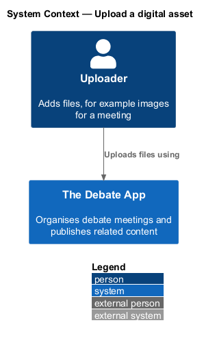
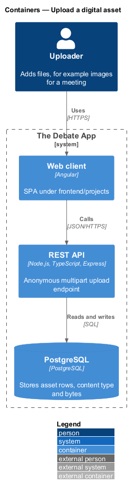
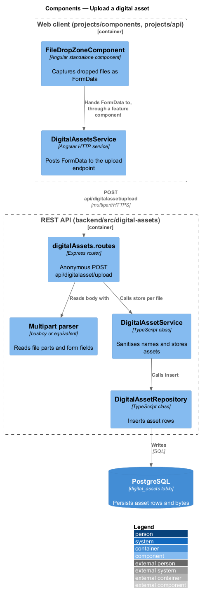
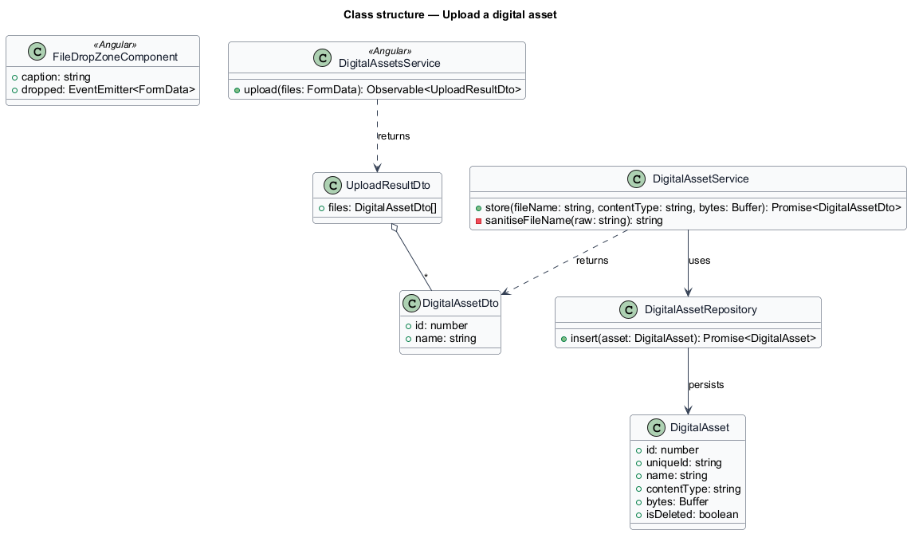
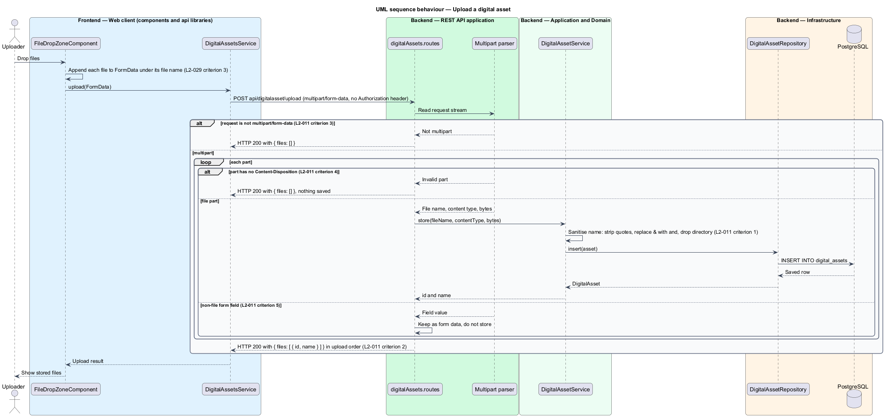

# Upload a digital asset

## Overview

The Debate App stores uploaded files in its database. A *digital asset* is a stored file with a name, a content type, its bytes and a unique identifier. This feature accepts one or more files in a `multipart/form-data` request and stores each file as a digital asset.

**file drop zone** — reusable component that shows a caption, accepts dragged files and emits them as `FormData`

The upload endpoint is anonymous. A caller posts files, the API reads each file part fully into memory, stores it, and returns the `id` and `name` of every stored file in upload order. `digital-assets/serve-digital-asset` serves the stored file later.

The first client of the upload is the insert-image action of the rich-text editor. The mocks defer that dialog (`docs/mocks/README.md`, question 3), so the visible upload interface is `<TO SUPPLY>`. The reusable drop zone is specified by L2-029 and is the intended input.

## Description

The slice runs from the drop zone to the `digital_assets` table.

- **`FileDropZoneComponent`** — presentational component in `projects/components/src/lib/file-drop-zone`. It shows the `caption` input or `Drop Zone`, prevents the default on `dragover`, and on `drop` emits an event whose payload is a `FormData` with each file appended under its own file name. It makes no HTTP call. The attributes `height`, `width`, `background-color`, `color` and `font-family` map to CSS custom properties (L2-029).
- **`DigitalAssetsService.upload`** — HTTP service in `projects/api/src/lib/services`. It sends `POST api/digitalasset/upload` with the `FormData` and without a `Content-Type` override, so the browser sets the multipart boundary. This is an exception to the default JSON header of L2-025. A feature component passes the emitted `FormData` from the drop zone to the service, because `components` and `api` do not depend on each other.
- **`digitalAssets.routes`** — Express router. The upload route runs a multipart parser and applies no authentication middleware. The parser library (for example `busboy`) is `<TO SUPPLY>`.
- **`DigitalAssetService.store`** — application service. It sanitises the file name and inserts the asset with a fresh `unique_id`.
- **`DigitalAssetRepository.insert`** — data access.

**File name rules** (L2-011 criterion 1). The service strips surrounding quotes, replaces `&` with `and`, and removes the directory portion. The stored `content_type` is the `Content-Type` header of the part.

**Error handling.** The legacy API catches and swallows parse errors and answers HTTP 200 with `{ files: [] }` (L2-011 criteria 3 and 4). The design keeps that observable result. Whether a malformed request deserves HTTP 400 instead is `<TO SUPPLY>`.

**Limits.** Each file is held fully in memory, so a maximum file size and a maximum file count protect the process. Both values are `<TO SUPPLY>`. The permitted content types are `<TO SUPPLY>`.

**Authentication.** The upload is accepted without an `Authorization` header (L2-011 criterion 6). Whether the new API restricts it is `<TO SUPPLY>`.

| Case | Response |
|------|----------|
| One or more file parts | HTTP 200 `{ files: [ { id, name }, ... ] }` |
| Not `multipart/form-data` | HTTP 200 `{ files: [] }` |
| Part without `Content-Disposition` | HTTP 200 `{ files: [] }`, nothing saved |
| Non-file form field | Read as form data, not stored |

## Requirements

| L2 ID | Refines (L1) | Requirement |
|-------|--------------|-------------|
| `L2-011` | `L1-005` | `POST api/digitalasset/upload` shall be anonymous and shall accept `multipart/form-data`. For each file part, a `DigitalAsset` shall be saved with `FileName` equal to the part's file name (surrounding quotes stripped, `&` replaced with `and`, directory portion removed), `Bytes` equal to the file content and `ContentType` equal to the part's `Content-Type` header. A successful upload shall return HTTP 200 with `{ files: [ { id, name }, ... ] }`, one entry per stored file in upload order. A request that is not `multipart/form-data`, or a part that lacks a `Content-Disposition` header, shall return HTTP 200 with `{ files: [] }`, and nothing shall be saved in the failing case. Non-file form fields shall be read into form data and shall not be stored as assets. |
| `L2-029` | `L1-013` | The file drop zone shall show an anchor whose text is the `caption` attribute or `Drop Zone`, shall prevent the default on `dragover`, and on `drop` shall dispatch a `[Drop Zone] Drop` event whose `detail.files` is a `FormData` containing each file appended under its own file name. |
| `L2-017` | `L1-008` | The system shall return JSON with camelCase property names for every API response. |

## Diagrams

### System context

The uploader sends files to The Debate App. The endpoint is anonymous.

### Containers

The web client posts `FormData` to the REST API, which stores the bytes in PostgreSQL.

### Components

The drop zone emits `FormData`, and `DigitalAssetsService` posts it. In the API, the router parses the multipart body and calls `DigitalAssetService.store`.

### Class structure

`UploadResultDto` holds the list of stored files. `DigitalAssetService.store` returns one `DigitalAssetDto` per file.

### Behaviour — upload

The router reads each part. Non-multipart requests and parts without a `Content-Disposition` header return an empty file list (L2-011).

