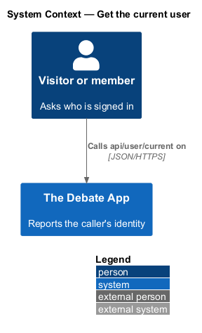
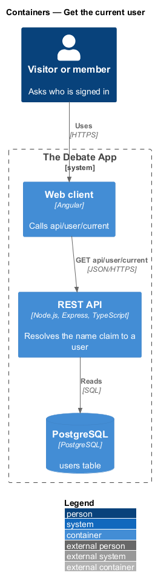
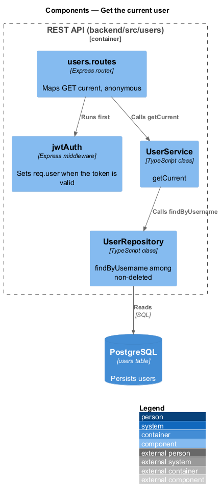
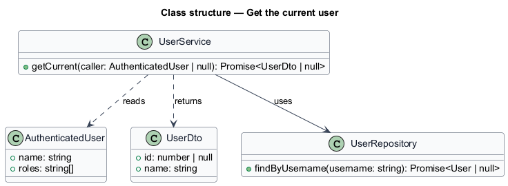
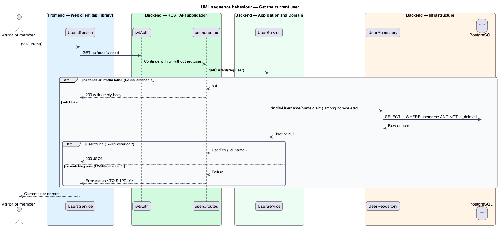

# Get the current user

## Overview

A client asks the API who the caller is. The answer is the user record that matches the name claim of the caller's token, or an empty body when the caller is anonymous.

**name claim** — token claim that carries the username of the signed-in user

**current user** — non-deleted user whose `username` equals the name claim

The endpoint is anonymous so that a client can call it before it knows whether a valid token is held. The web client may use the result to show the signed-in name. Which screen consumes it is `<TO SUPPLY>`; the mocks do not define one.

## Description

The slice lives in `backend/src/users`.

- **`users.routes`** — maps `GET api/user/current`. The route runs `jwtAuth` but not `requireAuth`, so an absent or invalid token leaves `req.user` unset (see `identity/validate-bearer-token`).
- **`UserService.getCurrent`** — returns null when `req.user` is unset. Otherwise it calls the repository with the name claim.
- **`UserRepository.findByUsername`** — returns the non-deleted user with the matching `username`.
- **`UserDto`** — `{ id, name }`.

An empty body is sent with HTTP 200. When a valid token names no non-deleted user, the legacy endpoint failed with a server error. The rewrite status code is `<TO SUPPLY>`.

## Requirements

| L2 ID | Refines (L1) | Requirement |
|-------|--------------|-------------|
| `L2-009` | `L1-004` | `GET api/user/current` with no bearer token or an invalid one shall return HTTP 200 with an empty body. |
| `L2-009` | `L1-004` | `GET api/user/current` with a valid bearer token whose name claim matches a non-deleted user's `Username` shall return HTTP 200 with that user's `{ id, name }`. |
| `L2-009` | `L1-004` | `GET api/user/current` with a valid bearer token whose name claim matches no non-deleted user shall fail. The status code is `<TO SUPPLY>`. |

## Diagrams

### System context

A visitor or member asks The Debate App who they are.

### Containers

The web client calls the REST API, which reads the `users` table when a valid token is present.

### Components

`users.routes` runs `jwtAuth`, then calls `UserService.getCurrent`, which uses `UserRepository`.

### Class structure

`UserService.getCurrent` takes an optional `AuthenticatedUser` and returns a `UserDto` or null.

### Behaviour — get the current user

An anonymous call returns an empty 200, a valid token returns the user, and a token naming no user fails (L2-009).

