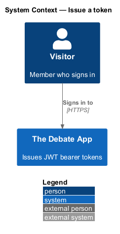
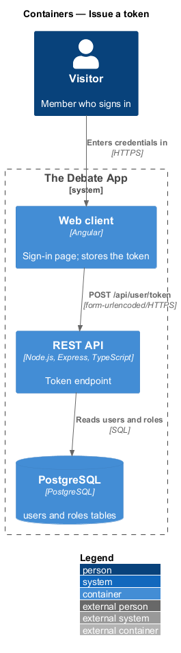
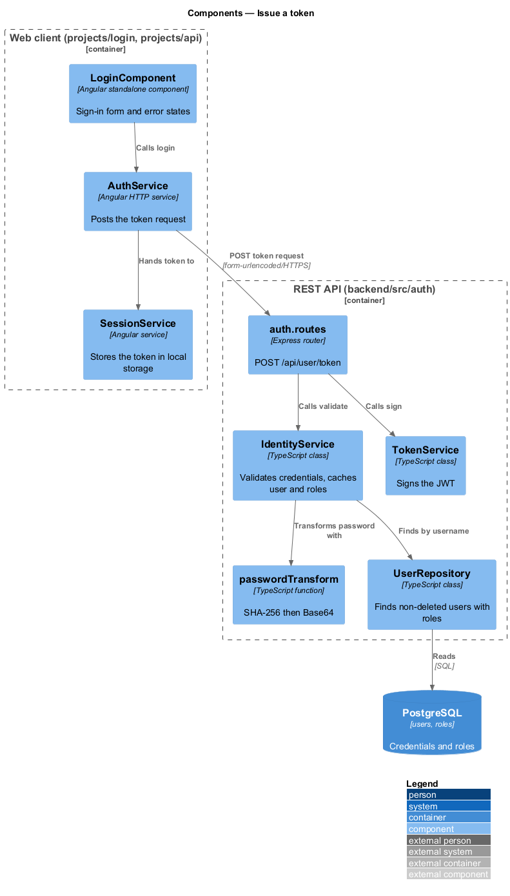
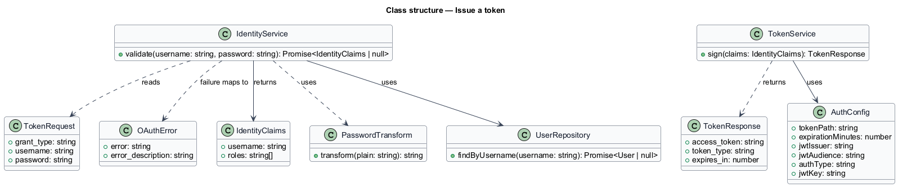
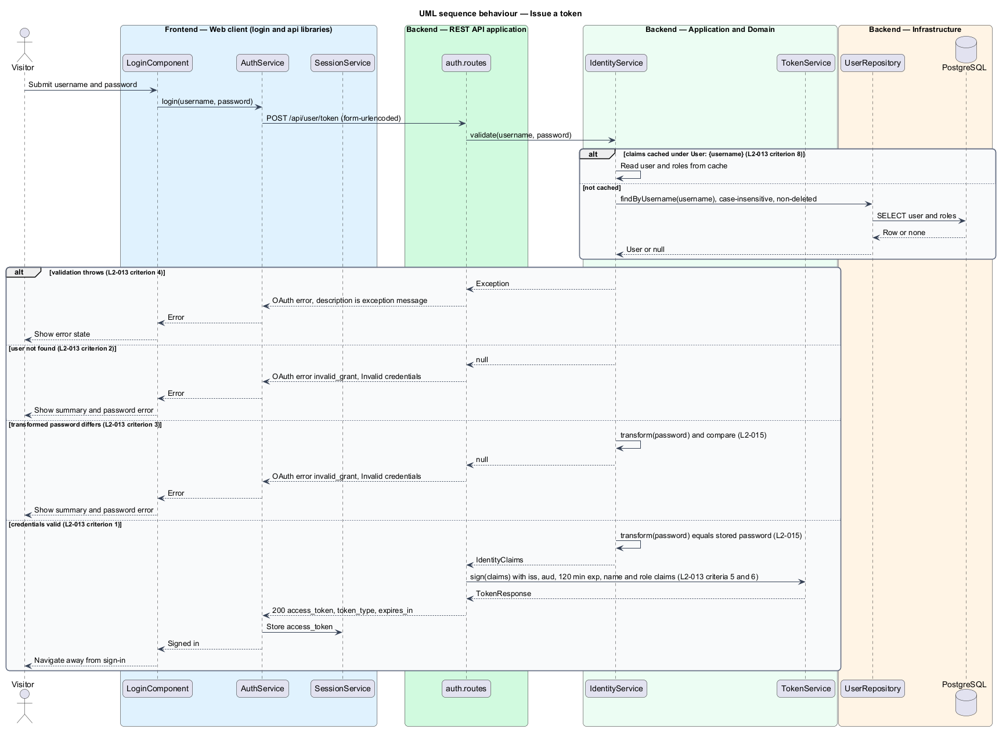
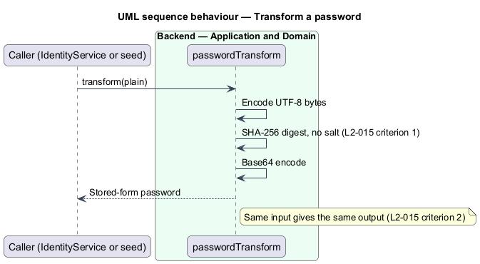

# Issue a token

## Overview

A visitor proves who they are by sending a username and password to the token endpoint and receives a JSON Web Token (JWT) in return. The web client stores the token and attaches it to later requests.

**JWT** — signed, self-contained token carrying claims such as issuer, audience, expiry, name and roles

**resource owner password grant** — OAuth2 flow in which the client posts `grant_type=password` with the user's username and password to a token endpoint

**password transform** — one-way function that turns a plaintext password into the stored value: Base64 of the SHA-256 hash of the UTF-8 bytes, with no salt (L2-015)

The sign-in page (`pages/sign-in`) defines the visible states: default, submitting, invalid credentials, error and session expired. Tokens last 120 minutes.

## Description

The slice runs from the Angular sign-in page to the `users` and `roles` tables.

- **`LoginComponent`** — smart component in `projects/login/src/lib`. It submits the form, shows the summary and password error for invalid credentials, and navigates after success.
- **`AuthService`** — HTTP service in `projects/api/src/lib/services`. It posts `application/x-www-form-urlencoded` to `/api/user/token` and hands the result to the session service.
- **`SessionService`** — stores the bearer token in local storage (L2-026).
- **`auth.routes`** — Express router in `backend/src/auth`. It maps `POST /api/user/token`, parses the form body and returns OAuth-shaped JSON. Plain HTTP is accepted.
- **`TokenService`** — signs the JWT with HMAC-SHA256 (`jsonwebtoken`). Claims: `iss`, `aud`, `exp`, one name claim equal to the submitted username, and one role claim per role.
- **`IdentityService`** — validates credentials and loads claims. It matches `username` case-insensitively among non-deleted users, compares the transformed password, and caches the user and roles under `User: {username}`.
- **`passwordTransform`** — shared function used by both seeding and validation.
- **`authConfig`** — values from the environment: `tokenPath` `/api/user/token`, `expirationMinutes` 120, `jwtIssuer` `localhost`, `jwtAudience` `all`, `authType` `olivia`, and `jwtKey` (Base64). The key value is `<TO SUPPLY>`.

Failures return an OAuth error: `error` `invalid_grant` with `error_description` `Invalid credentials`, or the exception message when validation throws. The HTTP status of an OAuth error is `<TO SUPPLY>`; RFC 6749 specifies 400.

Criterion 1 requires the stored password match for a user whose `Username` matches exactly, while the lookup is case-insensitive. The rewrite applies the exact comparison after the case-insensitive lookup.

## Requirements

| L2 ID | Refines (L1) | Requirement |
|-------|--------------|-------------|
| `L2-013` | `L1-006` | `POST /api/user/token` with `Content-Type: application/x-www-form-urlencoded` and body `grant_type=password&username={u}&password={p}` shall return HTTP 200 with an `access_token` JWT, `token_type` and `expires_in` when `{u}` matches a non-deleted user's `Username` case-insensitively and the transform of `{p}` equals the stored `Password`. |
| `L2-013` | `L1-006` | When the username matches no non-deleted user, the response shall be an OAuth error with description `Invalid credentials`. |
| `L2-013` | `L1-006` | When the username matches and the transformed password does not, the response shall be an OAuth error with description `Invalid credentials`. |
| `L2-013` | `L1-006` | When credential validation throws, the response shall be an OAuth error whose description is the exception message. |
| `L2-013` | `L1-006` | An issued token shall carry `iss` of `localhost`, `aud` of `all` and `exp` 120 minutes after issuance, and shall be signed with HMAC-SHA256 using the Base64-decoded `jwtKey`. |
| `L2-013` | `L1-006` | An issued token shall contain one name claim equal to the submitted username and one role claim per role name attached to the user. |
| `L2-013` | `L1-006` | A token request over plain HTTP shall not be rejected for being insecure. |
| `L2-013` | `L1-006` | A second token request for the same username shall read the user and roles from the in-memory cache under key `User: {username}` instead of the database. |
| `L2-015` | `L1-006` | The password transform shall return the Base64 encoding of the SHA-256 hash of the UTF-8 bytes of the password, with no salt. |
| `L2-015` | `L1-006` | The password transform applied twice to the same password shall return identical results. |

## Diagrams

### System context

A visitor signs in to The Debate App and receives a token. No external identity provider is involved.

### Containers

The web client posts credentials to the REST API, which reads users and roles from PostgreSQL.

### Components

The sign-in page calls `AuthService`. In the API, the router calls `IdentityService` and `TokenService`, with a cache in front of `UserRepository`.

### Class structure

`IdentityService` validates credentials with `PasswordTransform`, and `TokenService` builds a `TokenResponse` from `AuthConfig`.

### Behaviour — issue a token

The API validates the credentials and returns a JWT, an `Invalid credentials` error for an unknown user or wrong password, or the exception message when validation throws (L2-013).

### Behaviour — transform a password

The transform hashes the UTF-8 bytes with SHA-256 and Base64-encodes the digest (L2-015).

