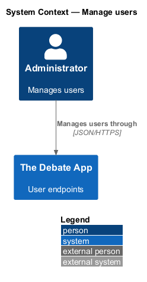
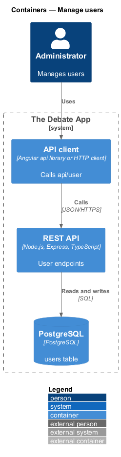
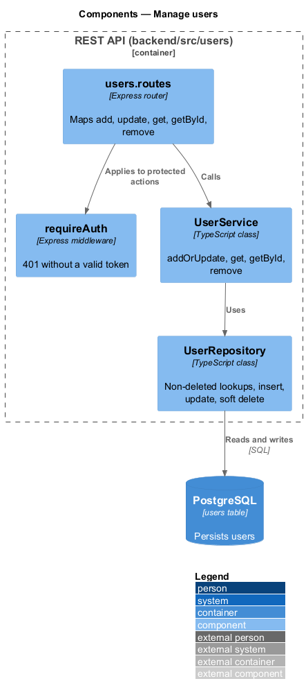
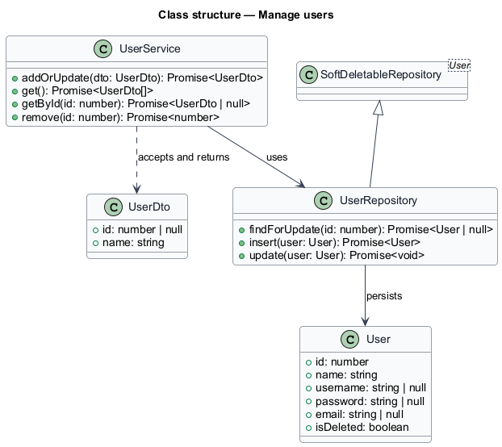
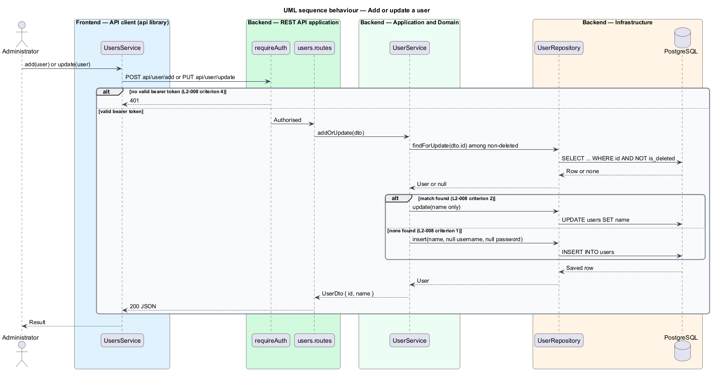
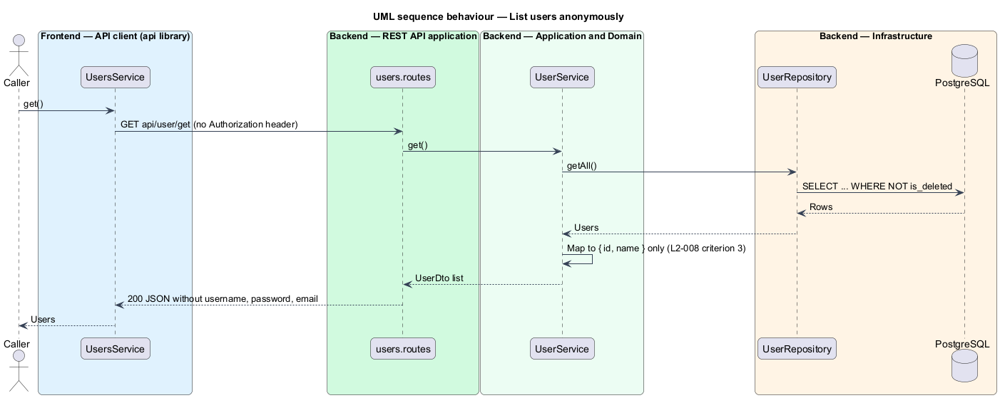
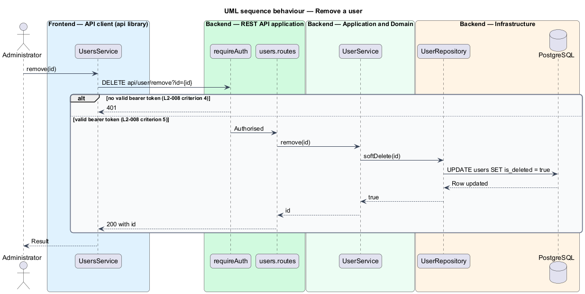

# Manage users

## Overview

The API exposes create, update, list, retrieve and remove operations for users. The DTO is deliberately small: it carries only an `id` and a `name`, so credentials and contact data never travel through these endpoints.

**user DTO** — JSON shape `{ id, name }` returned for a user; `id` is nullable on input

**add-or-update** — single operation that inserts a record when none matches the supplied `id` and overwrites the matching record otherwise

Registration, role assignment and invitation endpoints are out of scope (`docs/specs/L1.md`, Not Implemented). A user created here has a null `username` and `password`, so it cannot sign in.

## Description

The slice lives in `backend/src/users`.

- **`users.routes`** — Express router mounted at `api/user`. Routes: `POST add`, `PUT update`, `GET get` (anonymous), `GET getById`, `DELETE remove`. All but `get` use `requireAuth` (see `identity/validate-bearer-token`).
- **`UserService`** — application service with `addOrUpdate`, `get`, `getById` and `remove`. `addOrUpdate` sets only `name`.
- **`UserRepository`** — extends `SoftDeletableRepository` (see `platform/soft-delete`). Every lookup filters on `is_deleted = false`.
- **`UserDto`** — `{ id: number | null, name: string }`. A mapper function builds it from a `User` row and never copies `username`, `password` or `email`.

No UI consumes these endpoints in the first release; articles and user UI are out of scope (`AGENTS.md`). The status code for an unauthenticated call is 401. The behaviour of `getById` for an unknown `id` is `<TO SUPPLY>`.

## Requirements

| L2 ID | Refines (L1) | Requirement |
|-------|--------------|-------------|
| `L2-008` | `L1-004` | With a valid bearer token, `POST api/user/add` with `{ name }` shall create a user with that `name` and null `username` and `password`, and shall return HTTP 200 with `{ id, name }`. |
| `L2-008` | `L1-004` | With a valid bearer token and a non-deleted user with the request `id`, `PUT api/user/update` shall overwrite only `name`. |
| `L2-008` | `L1-004` | Without credentials, `GET api/user/get` shall return HTTP 200 with all non-deleted users as `{ id, name }`, and the response shall not contain `password`, `username` or `email`. |
| `L2-008` | `L1-004` | Without credentials, a call to `getById`, `add`, `update` or `remove` shall receive HTTP 401. |
| `L2-008` | `L1-004` | With a valid bearer token, `DELETE api/user/remove?id={id}` for an existing user shall set `is_deleted` to true and return HTTP 200 with the `id`. |

## Diagrams

### System context

A signed-in administrator manages users in The Debate App through the API.

### Containers

A client calls the REST API, which reads and writes the `users` table in PostgreSQL.

### Components

The router guards actions with `requireAuth` and calls `UserService`, which uses `UserRepository`.

### Class structure

`UserService` maps `User` rows to `UserDto`, which omits credential and contact fields.

### Behaviour — add or update a user

A request without a token is answered with 401. A valid request inserts a new user, or overwrites the name of the matching non-deleted user (L2-008).

### Behaviour — list users anonymously

The anonymous `get` action returns `{ id, name }` for non-deleted users (L2-008).

### Behaviour — remove a user

A valid request flags the user as deleted and returns the `id` (L2-008).

