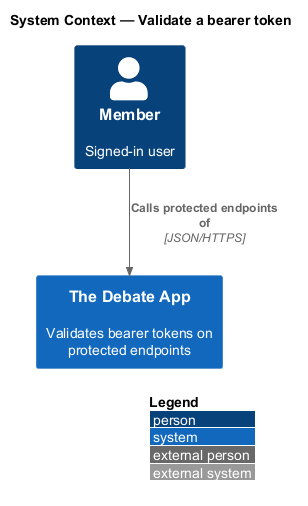
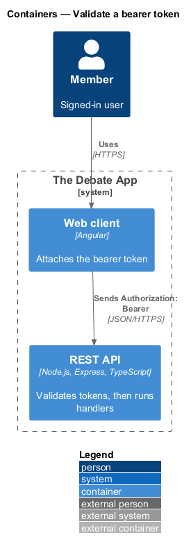
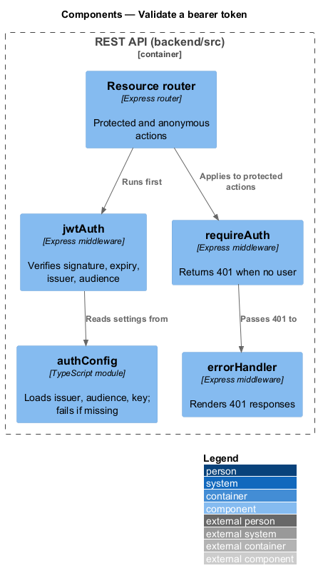
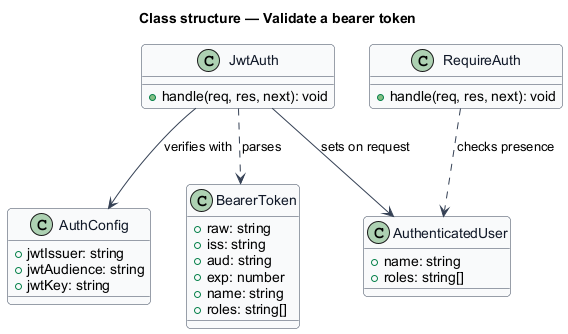
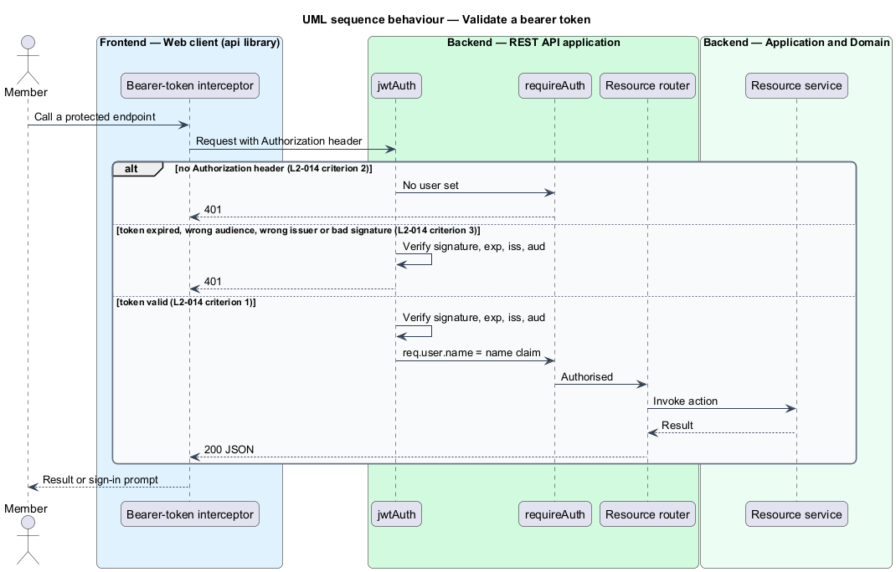
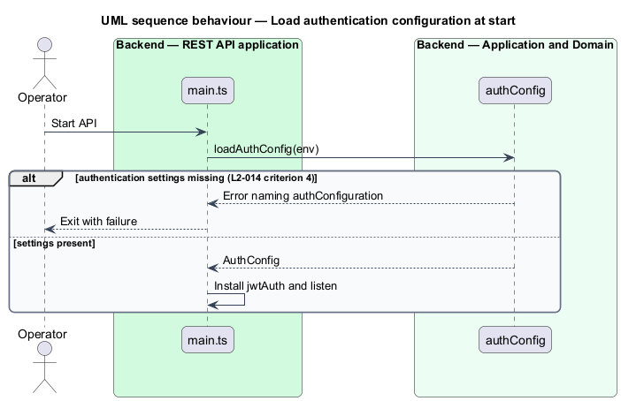

# Validate a bearer token

## Overview

Protected endpoints accept only requests that carry a valid JWT. This feature is the check that runs before a protected handler and decides between authorising the request and answering HTTP 401.

**protected endpoint** — action that requires an authenticated caller; every action of a resource except those explicitly marked anonymous

**anonymous endpoint** — action reachable without an `Authorization` header, for example the `get` action of each resource and the token endpoint

**bearer token** — token sent in the header `Authorization: Bearer {token}`

The check is the only authentication source. The bearer token is the sole credential.

## Description

The slice lives in `backend/src/middleware` and `backend/src/config`.

- **`jwtAuth`** — Express middleware in `backend/src/middleware`. It reads the `Authorization` header, verifies the signature, expiry, issuer and audience with `jsonwebtoken`, and sets `req.user.name` from the name claim.
- **`requireAuth`** — route guard that returns HTTP 401 when `req.user` is absent. Routers apply it per action; anonymous actions omit it.
- **`authConfig`** — loads issuer, audience and Base64 key from the environment. `loadAuthConfig` throws at startup when the settings are missing, naming `authConfiguration`.
- **`errorHandler`** — renders the 401 body. The body shape is `<TO SUPPLY>`.

Verification uses HMAC-SHA256 with the Base64-decoded key, matching the issuing side (see `identity/issue-token`).

## Requirements

| L2 ID | Refines (L1) | Requirement |
|-------|--------------|-------------|
| `L2-014` | `L1-006` | A request to a protected endpoint carrying `Authorization: Bearer {valid token}` shall be authorised, and `User.Identity.Name` shall equal the token's name claim. |
| `L2-014` | `L1-006` | A request to a protected endpoint without an `Authorization` header shall receive HTTP 401. |
| `L2-014` | `L1-006` | A request to a protected endpoint with an expired token, a wrong audience, a wrong issuer or an invalid signature shall receive HTTP 401. |
| `L2-014` | `L1-006` | The application shall fail at startup, naming `authConfiguration`, when the authentication configuration is missing. |

## Diagrams

### System context

A signed-in member calls protected endpoints. The token comes from The Debate App itself.

### Containers

The web client attaches the token, and the REST API validates it before reaching a handler. PostgreSQL is not involved in validation.

### Components

`jwtAuth` verifies the token using `authConfig`, and `requireAuth` guards each protected route.

### Class structure

`JwtAuth` produces an `AuthenticatedUser` from a `BearerToken` using `AuthConfig`.

### Behaviour — validate a bearer token

A request is authorised with a valid token, and answered with 401 when the header is absent or the token fails verification (L2-014).

### Behaviour — load authentication configuration at start

Startup fails when the authentication settings are missing (L2-014).

