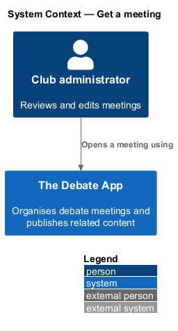
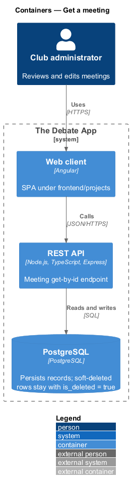
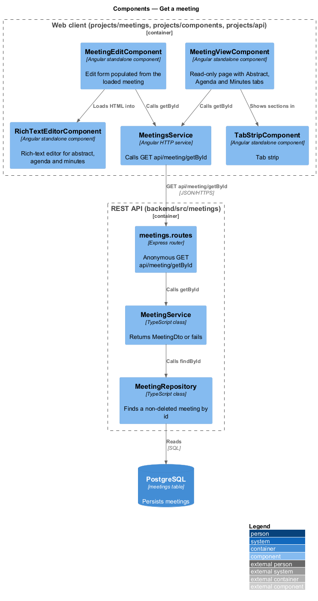
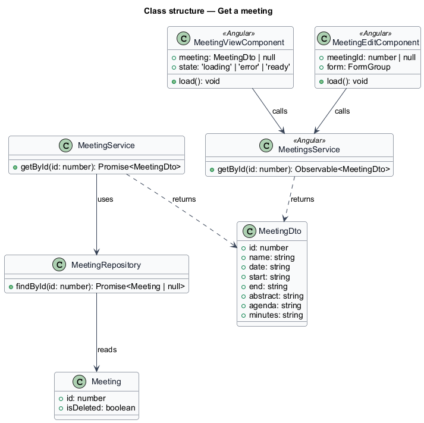
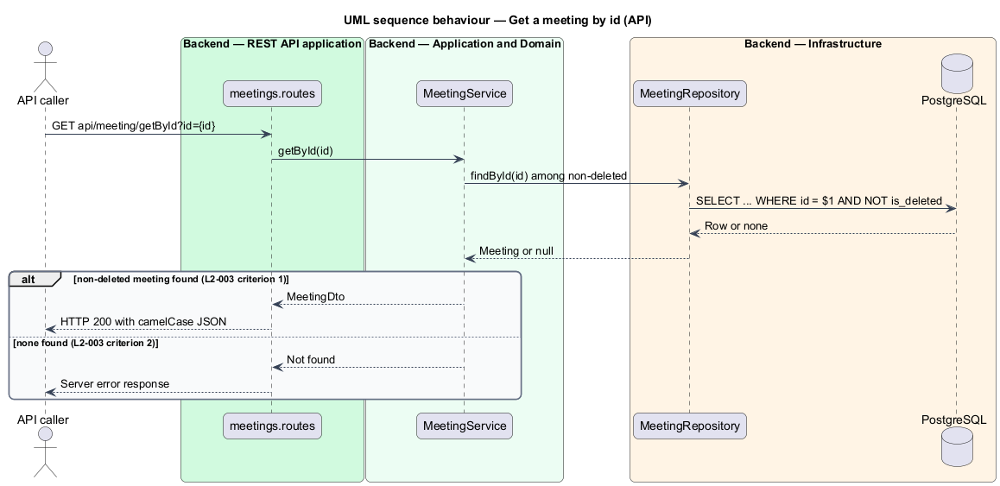
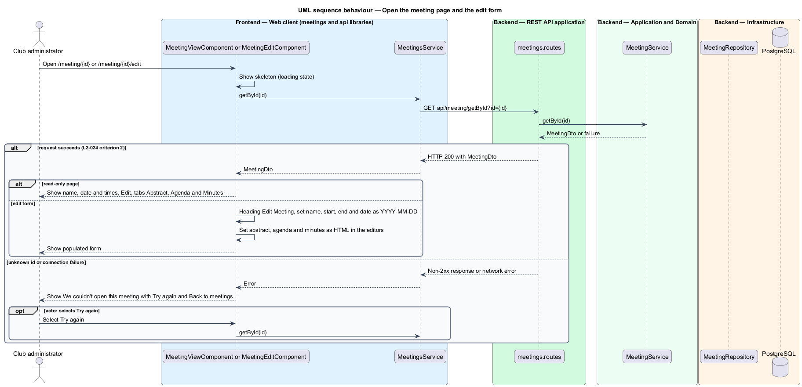

# Get a meeting

## Overview

The Debate App organises debate meetings for a club. A *meeting* is a scheduled club session with a name, a date, a start and end time, an abstract, an agenda and minutes. This feature retrieves one meeting by its identifier and shows it either read-only or in the edit form.

**read-only meeting page** — page at `/meeting/:id` that shows one meeting in three tabs (Abstract, Agenda, Minutes) with a single Edit action

The API exposes `GET api/meeting/getById?id={id}`. It returns the meeting when a non-deleted meeting has that `id`. Two client pages consume it: the read-only meeting page, opened by View, and the edit form, opened by Edit. The create form does not call it.

The legacy client sent both View and Edit to `/meeting/{id}` (L2-019, L2-023). The mocks separate the two: `/meeting/:id` is the read-only page and `/meeting/:id/edit` is the form (`docs/mocks/README.md`, question 1). The reconciliation with L2-019 is `<TO SUPPLY>`.

## Description

The slice runs from two Angular pages to the `meetings` table.

- **`MeetingViewComponent`** — smart component in `projects/meetings/src/lib/meeting-view`. It loads one meeting and renders the name as the heading, the date and time range, an Edit action and a tab strip with Abstract, Agenda and Minutes. A section without content shows an empty message inside its tab.
- **`MeetingEditComponent`** — smart component in `projects/meetings/src/lib/meeting-edit`. When the route carries an `id`, it calls `MeetingsService.getById` and then fills the form. The save behaviour belongs to `meetings/save-meeting`.
- **`TabStripComponent`** — presentational component in `projects/components/src/lib/tab-strip` that shows the three tabs (L2-028).
- **`RichTextEditorComponent`** — presentational component in `projects/components/src/lib/rich-text-editor`. The edit form sets the loaded HTML into it.
- **`MeetingsService.getById`** — sends `GET api/meeting/getById?id={id}`.
- **`meetings.routes`**, **`MeetingService.getById`**, **`MeetingRepository.findById`** — backend route, application service and data access. `findById` filters on `is_deleted = false`.

**Missing meeting.** The legacy service dereferences a null result, so an unknown or deleted `id` produces a server error (L2-003 criterion 2). The design keeps the observable result as a failed request. Whether the new API returns HTTP 404 or HTTP 500 is `<TO SUPPLY>`. The client treats any non-2xx response the same way.

**Page states** (mocks `pages/meeting`, `pages/meeting-edit`):

| State | Condition | Presentation |
|-------|-----------|--------------|
| default | Meeting loaded | Read-only page: name, `Tue 13 Oct · 7:00 pm–8:30 pm`, Edit and tabs. Edit form: heading `Edit Meeting` and populated fields |
| loading | Request outstanding | Skeleton that matches the final layout; the Edit action and Save are present and inactive |
| error | Request fails | `We couldn't open this meeting`, one line that names both causes (deleted or connection dropped), Try again and Back to meetings |
| edge | Long name, no date | The long name wraps; a null date shows no date text |

The form shows `date` as `YYYY-MM-DD` when present (L2-024 criterion 2). The API returns `date` in the shape defined by `meetings/list-meetings`.

## Requirements

| L2 ID | Refines (L1) | Requirement |
|-------|--------------|-------------|
| `L2-003` | `L1-001` | `GET api/meeting/getById?id={id}` shall be anonymous and shall return HTTP 200 with the `MeetingDto` of the non-deleted meeting that has the given `id`. When no non-deleted meeting has that `id`, the request shall fail with a server error. |
| `L2-024` | `L1-011` | When the edit component has a `meeting-id`, the heading shall be `Edit Meeting` and `GET /api/meeting/getbyid?id={id}` shall be called. On response, `name`, `start` and `end` shall populate their inputs, `abstract`, `agenda` and `minutes` shall be set as HTML into their editors, and `date` shall be shown formatted `YYYY-MM-DD` when present. |

## Diagrams

### System context

The administrator opens one meeting from the list. The same read serves the read-only page and the edit form.

### Containers

The web client calls the REST API, which reads one row from PostgreSQL.

### Components

Both pages call `MeetingsService.getById`. The tab strip and the editor are presentational components. The API path is router, service, repository.

### Class structure

`MeetingService.getById` returns a `MeetingDto` or fails when the repository returns null. The two page components share `MeetingsService`.

### Behaviour — get a meeting by id

The repository filters out soft-deleted rows. A null result makes the request fail (L2-003).

### Behaviour — open the meeting page and the edit form

Both pages load the meeting. The edit form populates its fields and editors (L2-024), and both pages show the error state when the request fails.

