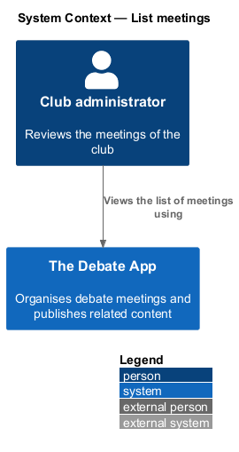
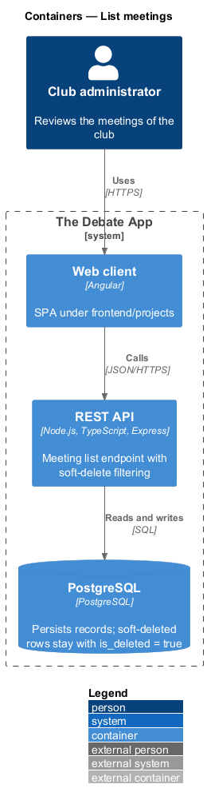
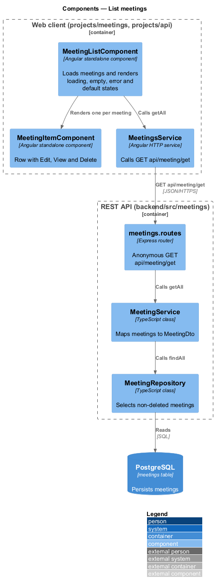
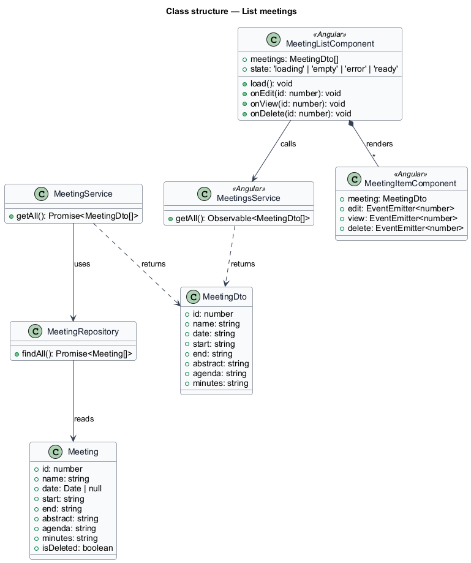
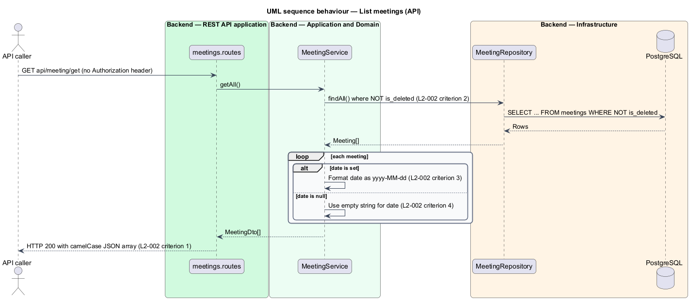
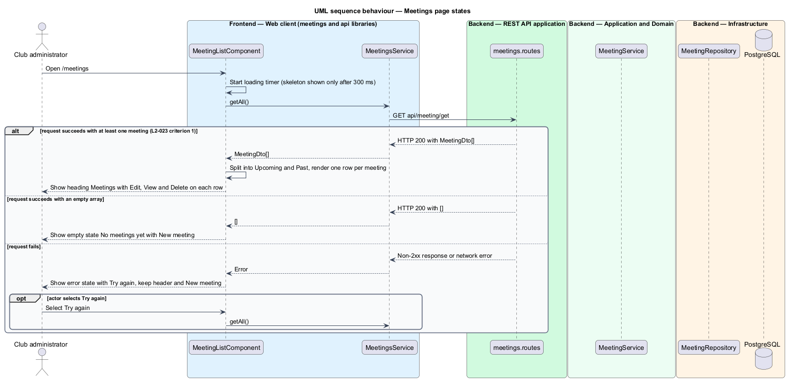

# List meetings

## Overview

The Debate App organises debate meetings for a club. A *meeting* is a scheduled club session with a name, a date, a start and end time, an abstract, an agenda and minutes. This feature returns the meetings that have not been removed and presents them on the meetings page.

**soft-deleted meeting** — meeting whose `isDeleted` flag is true and which is excluded from every read (L1-007)

The API exposes `GET api/meeting/get`, which is anonymous and returns every meeting that is not soft-deleted. The meetings page at `/meetings` calls that endpoint, groups the result into *Upcoming* and *Past*, and shows one row per meeting with the date, name, time range and abstract. Each row offers Edit, View and Delete.

The mocks `pages/meetings` define six states: default, loading, empty, error, long and edge. The states follow the product stance of `docs/mocks/README.md`: one primary action per screen, short copy and no motion other than the skeleton shimmer.

## Description

The slice runs from the Angular meetings page to the `meetings` table.

- **`MeetingListComponent`** — smart component in `projects/meetings/src/lib/meeting-list`. It loads meetings on init and renders the heading `Meetings`, a summary line, the New meeting action and one row per meeting. It replaces the legacy `ce-meetings` element (L2-023).
- **`MeetingItemComponent`** — row that renders the date block, the `name` as a heading, the time range and the `abstract` as HTML. It exposes `edit`, `view` and `delete` outputs, one per anchor (L2-023 criterion 2). Whether the row stays local to the meetings feature or moves to `projects/components` is `<TO SUPPLY>`.
- **`MeetingsService`** — HTTP service in `projects/api/src/lib/services`. `getAll()` sends `GET api/meeting/get`.
- **`MeetingDto`** — interface in `projects/api/src/lib/models`: `id`, `date`, `start`, `end`, `abstract`, `agenda`, `minutes`, `name`.
- **`meetings.routes`** — Express router in `backend/src/meetings`. It maps `GET api/meeting/get` to the list handler and applies no authentication middleware.
- **`MeetingService`** — application service. `getAll` maps each `Meeting` to a `MeetingDto` and formats `date` as `yyyy-MM-dd`, or as an empty string when the date is null.
- **`MeetingRepository`** — data access. `findAll` filters on `is_deleted = false`. The order of the array is `<TO SUPPLY>`; the page performs its own grouping.

**Page states** (mocks `pages/meetings`):

| State | Condition | Presentation |
|-------|-----------|--------------|
| default | Array has meetings | Heading, summary line, New meeting, Upcoming group and Past group |
| loading | Request outstanding for more than 300 ms | Skeleton rows that match the final layout, so nothing shifts; header and New meeting stay |
| empty | Array is empty | `No meetings yet`, one line that invites the first meeting, and New meeting |
| error | Request fails | `We couldn't load the meetings`, a retry hint and Try again; header and New meeting stay so the person is never stranded |
| long | Many meetings (the mock has 18 further weekly meetings) | Same rows, grouped; pagination or virtual scrolling is `<TO SUPPLY>` |
| edge | Long names, null dates, missing abstracts | Long names wrap, a null `date` renders as an em dash with `tbc`, `Date not set` replaces the time line, and `No abstract yet` replaces a missing abstract |

The summary line counts upcoming meetings and counts meetings without a date separately (`2 upcoming · 1 without a date` in the edge mock). The rule that classifies a meeting as upcoming or past, including the treatment of the current day, of a null `date` and of the time zone, is `<TO SUPPLY>`.

The API keeps the legacy date format `yyyy-MM-dd` so existing clients continue to parse it.

## Requirements

| L2 ID | Refines (L1) | Requirement |
|-------|--------------|-------------|
| `L2-002` | `L1-001` | `GET api/meeting/get` shall be anonymous and shall return HTTP 200 with a JSON array of `MeetingDto` objects for every meeting whose `isDeleted` is false. A soft-deleted meeting shall be absent from the array. `date` shall be a string formatted `yyyy-MM-dd`, or an empty string when the meeting has no date. |
| `L2-023` | `L1-011` | The meeting list shall load meetings from `GET /api/meeting/get` and shall show the heading `Meetings` followed by one item per meeting. Each item shall show the `name` in an `h2`, the `abstract` as HTML in a `p`, and three anchors labelled `Edit`, `View` and `Delete`. `Edit` and `View` shall navigate to `/meeting/{id}`, and a successful `DELETE /api/meeting/remove?id={id}` shall remove the item from the list without a reload. |

## Diagrams

### System context

The club administrator reaches the list through The Debate App. The list endpoint is anonymous, so an unauthenticated caller can also use it.

### Containers

The web client calls the REST API, which reads the `meetings` table in PostgreSQL.

### Components

The page calls `MeetingsService`. In the API, the router calls `MeetingService`, which reads through `MeetingRepository`.

### Class structure

`MeetingService` maps `Meeting` entities to `MeetingDto` objects. The row component raises `edit`, `view` and `delete` outputs.

### Behaviour — list meetings

The router calls the service without authentication. The repository excludes soft-deleted rows, and the service formats each date (L2-002).

### Behaviour — meetings page states

The page shows the loading, empty, error or default state depending on the outcome of the request (L2-023). Try again repeats the same request.

