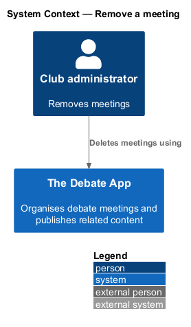
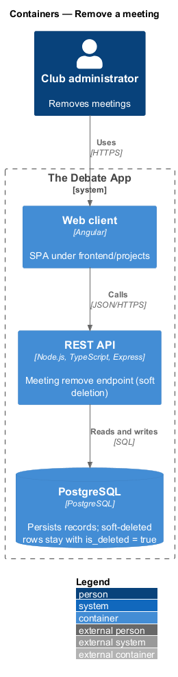
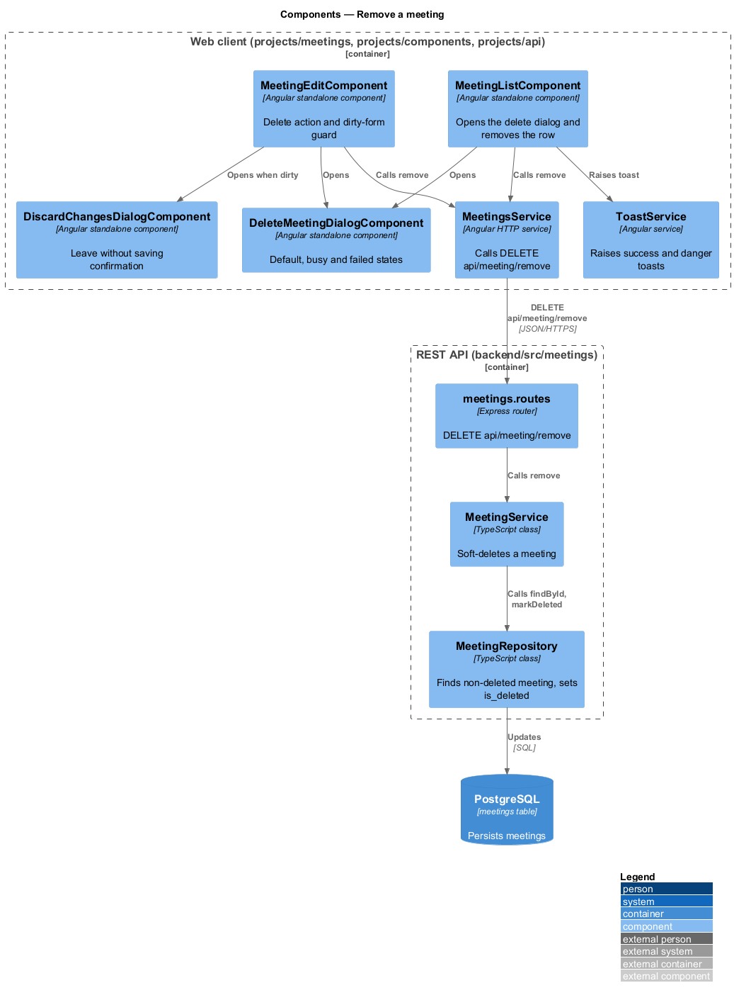
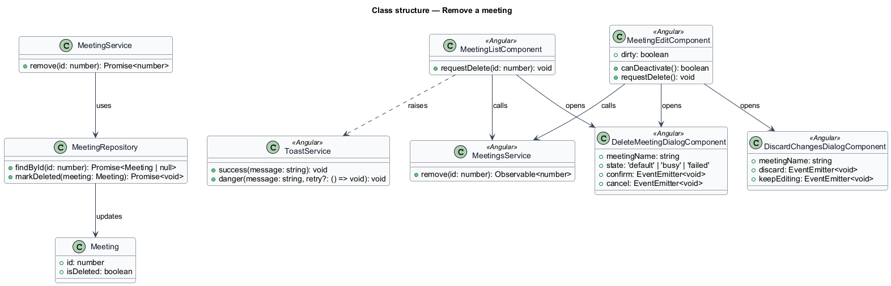
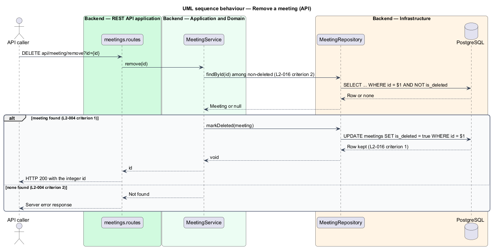
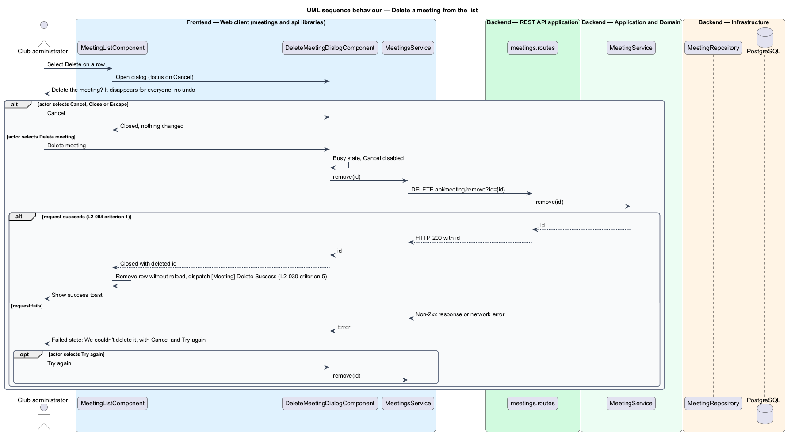
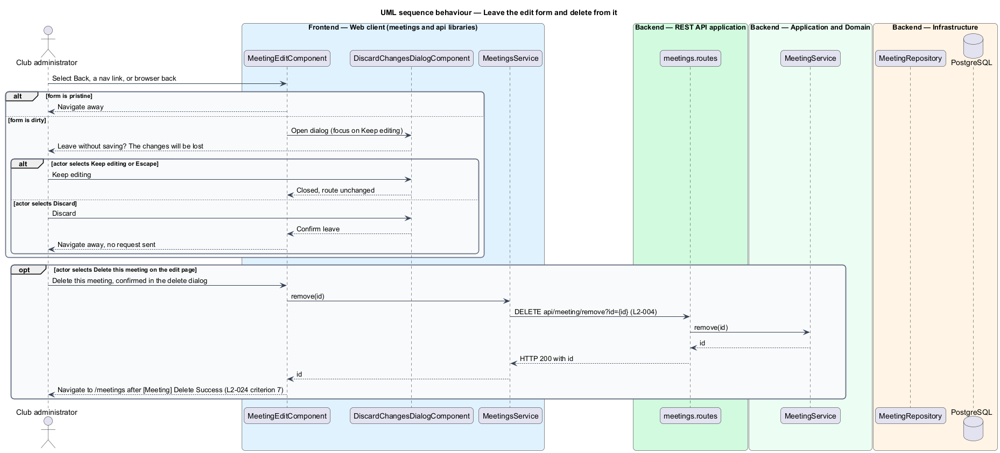

# Remove a meeting

## Overview

The Debate App organises debate meetings for a club. A *meeting* is a scheduled club session with a name, a date, a start and end time, an abstract, an agenda and minutes. This feature removes a meeting from every list and read.

**soft deletion** — removal that sets the `is_deleted` flag on a row and leaves the row in the database (L1-007)

The API exposes `DELETE api/meeting/remove?id={id}`. It marks the meeting as deleted and returns its `id`. The API has no restore operation, so the client confirms the action once in a dialog and offers no Undo.

Two entry points exist. The Delete anchor on a list row removes the meeting and the row leaves the list. The Delete action on the edit form removes the meeting and returns to the list. A second dialog, *discard changes*, protects the edit form when the person leaves it with unsaved edits. The dialog belongs to this design because it shares the confirmation pattern and the navigation outcome.

## Description

The slice runs from the meetings list and the edit form to the `meetings` table.

- **`DeleteMeetingDialogComponent`** — presentational dialog with the inputs meeting name and state, and the outputs `confirm` and `cancel`. The title reads `Delete “{name}”?` and the line reads `It disappears from the list for everyone. There's no undo.` Focus starts on Cancel and never on the destructive button. Escape and Close cancel. Under 640 px the dialog renders as a bottom sheet. Whether a generic confirm dialog in `projects/components` replaces a meeting-specific dialog is `<TO SUPPLY>`.
- **`DiscardChangesDialogComponent`** — presentational dialog with the title `Leave without saving?`, a line that names the meeting and states that its changes are lost, and the actions Discard and Keep editing. Keep editing is primary and holds focus. Escape also keeps editing.
- **`MeetingListComponent`** and **`MeetingEditComponent`** — smart components in `projects/meetings`. Each owns the dialog state and calls `MeetingsService.remove`. The edit component also holds a dirty-form route guard that opens the discard dialog on Back, on a navigation link and on browser back.
- **`MeetingsService.remove`** — sends `DELETE api/meeting/remove?id={id}`.
- **`ToastService`** — raises toasts. Its location (`projects/components` or the application shell) is `<TO SUPPLY>`.
- **`meetings.routes`**, **`MeetingService.remove`**, **`MeetingRepository`** — backend route, application service and data access. `remove` loads the non-deleted meeting, sets `is_deleted = true` and saves.

**Dialog states** (mocks `dialogs/delete-meeting`, `dialogs/discard-changes`):

| Dialog | State | Presentation |
|--------|-------|--------------|
| Delete meeting | default | Title, consequence line, Cancel and the destructive Delete meeting action; focus on Cancel |
| Delete meeting | busy | The destructive action reads `Deleting…`; Cancel is disabled so the result is unambiguous; the dialog closes itself on success and the row leaves |
| Delete meeting | failed | The dialog stays open with `We couldn't delete it`, a connection hint, Cancel and Try again; nothing behind the dialog changes |
| Discard changes | default | `Leave without saving?`, Discard and Keep editing |

**Notifications** (mocks `notifications/toast`). A success toast follows a save or a delete. It closes after 8 s, pauses on hover and carries no Undo action. A failed save raises a danger toast that never auto-dismisses, is announced with `role="alert"` and offers Try again. A failed delete stays inside the dialog and raises no toast.

**Events** (L2-030). Selecting Delete on a row dispatches `[Meeting] Delete` with `detail` `{ meetingId: id }`. A successful removal dispatches `[Meeting] Delete Success` with `detail` `{ meetingId: id }`. Whether these remain DOM `CustomEvent` instances or become typed outputs of the Angular components is `<TO SUPPLY>`.

**Missing meeting.** A removal for an unknown `id` fails with a server error in the legacy API (L2-004 criterion 2). The status code in the new API is `<TO SUPPLY>`.

**Repeated removal.** The repository lookup excludes soft-deleted rows, so a second removal of the same `id` takes the missing-meeting path.

## Requirements

| L2 ID | Refines (L1) | Requirement |
|-------|--------------|-------------|
| `L2-004` | `L1-001`, `L1-007` | `DELETE api/meeting/remove?id={id}` shall set `IsDeleted` to true on the meeting with the given `id`, save the change, and return HTTP 200 with the integer `id` as the body. When no meeting has the given `id`, the request shall fail with a server error. |
| `L2-016` | `L1-007` | A meeting removed through its `remove` action shall remain in the database with `IsDeleted = true`. A meeting with `IsDeleted = true` shall be excluded from `get` and `getById`. |
| `L2-023` | `L1-011` | When `Delete` is selected on a list item and `DELETE /api/meeting/remove?id={id}` succeeds, the item shall be removed from the list without reloading. |
| `L2-024` | `L1-011` | When Delete is selected on the edit form, `DELETE /api/meeting/remove?id={meeting-id}` shall be sent, and on success a `[Meeting] Delete Success` event shall be dispatched and the client shall navigate to `/meetings`. |
| `L2-030` | `L1-011` | `MeetingDeleteSelect(id)` shall have the type `[Meeting] Delete` and `detail` `{ meetingId: id }`. `MeetingDeleteSuccess(id)` shall have the type `[Meeting] Delete Success` and `detail` `{ meetingId: id }`. |

## Diagrams

### System context

The administrator removes a meeting through The Debate App. The removal is soft, so no data leaves the database.

### Containers

The web client calls the REST API, which updates the `is_deleted` column in PostgreSQL.

### Components

The list and edit components open the dialogs and call `MeetingsService.remove`. In the API, the service loads the meeting and the repository writes the flag.

### Class structure

`MeetingService.remove` loads a non-deleted `Meeting` and sets `isDeleted`. The dialog components expose `confirm` and `cancel` outputs.

### Behaviour — remove a meeting

The service loads the non-deleted meeting and sets the flag. A missing meeting makes the request fail (L2-004).

### Behaviour — delete from the list

The dialog moves through the default, busy and failed states. Success removes the row without a reload (L2-023).

### Behaviour — leave the edit form and delete from it

The discard dialog guards navigation while the form is dirty. The Delete action on the edit form uses the same removal call (L2-024).

