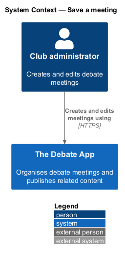
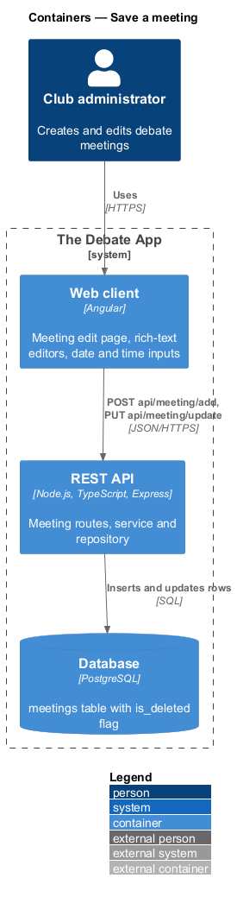
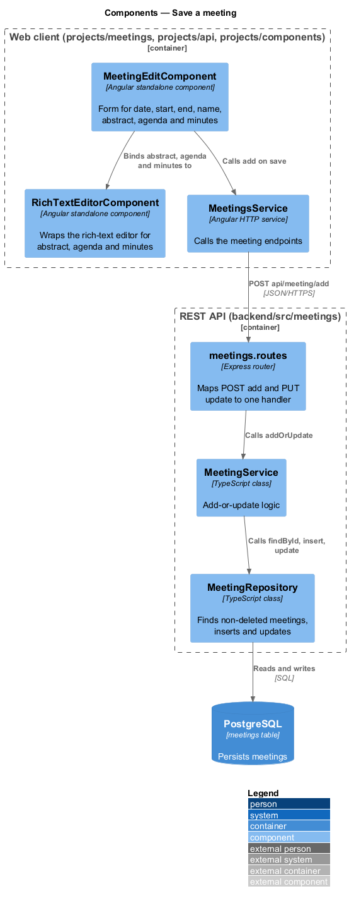
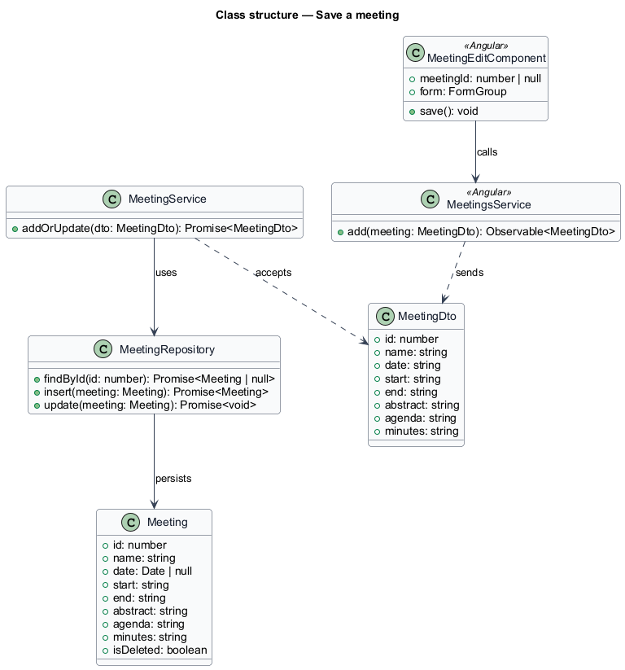
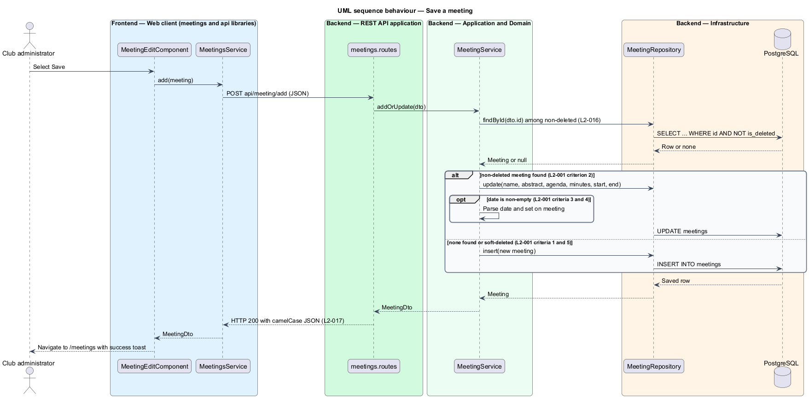

# Save a meeting

## Overview

The Debate App organises debate meetings for a club. A *meeting* is a scheduled club session with a name, a date, a start and end time, an abstract, an agenda and minutes. This feature covers creating a new meeting and changing an existing one.

**add-or-update** — single operation that creates a meeting when none matches the supplied `id` and overwrites the matching meeting otherwise

A club administrator opens the create or edit page, fills in the form, and selects Save. The web client sends one request, and the API applies the add-or-update operation. A meeting that was soft-deleted is never matched, so saving with the `id` of a deleted meeting inserts a new meeting (L1-007).

The create and edit pages use rich-text editors for the abstract, agenda and minutes, and date and time inputs for the date, start and end. The mocks `pages/meeting-create` and `pages/meeting-edit` define the visible states.

## Description

The slice runs from the Angular edit page to the `meetings` table.

- **`MeetingEditComponent`** — smart component in `projects/meetings/src/lib/meeting-edit`. It renders the heading `Create Meeting` or `Edit Meeting`, holds the form, and calls `MeetingsService.add` on Save. On success it navigates to `/meetings` and raises the success toast.
- **`RichTextEditorComponent`** — presentational component in `projects/components/src/lib/rich-text-editor`. It exposes the editor content as an HTML string through an input and an output.
- **`MeetingsService`** — HTTP service in `projects/api/src/lib/services`. It sends `POST api/meeting/add` with a `MeetingDto`.
- **`MeetingDto`** — interface in `projects/api/src/lib/models` mirroring the API resource: `id`, `date`, `start`, `end`, `abstract`, `agenda`, `minutes`, `name`.
- **`meetings.routes`** — Express router in `backend/src/meetings`. It maps `POST api/meeting/add` and `PUT api/meeting/update` to the same handler. Both routes are anonymous.
- **`MeetingService`** — application service in `backend/src/meetings`. `addOrUpdate` finds the non-deleted meeting, parses a non-empty `date`, and delegates to the repository.
- **`MeetingRepository`** — data access in `backend/src/meetings`. Every lookup filters on `is_deleted = false`.

Client-side validation is limited to two rules from the mocks: a name is required, and End shall be after Start. The API validates nothing. Whether these two rules stay is open in `docs/mocks/README.md` (question 5).

The route for the edit form is `/meeting/:id/edit` in the mocks, which differs from L2-019. The reconciliation is `<TO SUPPLY>`.

## Requirements

| L2 ID | Refines (L1) | Requirement |
|-------|--------------|-------------|
| `L2-001` | `L1-001` | `POST api/meeting/add` and `PUT api/meeting/update` shall call the same add-or-update logic, and a request without an `Authorization` header shall not be rejected for lack of authentication. |
| `L2-016` | `L1-007` | An add-or-update request carrying the `id` of a soft-deleted entity shall insert a new entity instead of updating the deleted one. |
| `L2-017` | `L1-008` | The system shall return JSON with camelCase property names for every API response. |
| `L2-024` | `L1-011` | Save shall send `POST /api/meeting/add` as JSON with `id`, `date`, `start`, `end`, `name`, `abstract`, `agenda` and `minutes`, and on success shall dispatch a `[Meeting] Add Success` event and navigate to `/meetings`. |
| `L2-025` | `L1-011`, `L1-012` | The client HTTP layer shall send `Content-Type: application/json;charset=UTF-8` by default. |

## Diagrams

### System context

The administrator saves meetings through The Debate App, which has no external dependency in this slice.

### Containers

The web client calls the REST API, which writes to the PostgreSQL database.

### Components

The edit component binds three editors and calls `MeetingsService`. In the API, the router calls `MeetingService`, which uses `MeetingRepository`.

### Class structure

`MeetingService` accepts a `MeetingDto` and persists a `Meeting` through `MeetingRepository`. The `Meeting` entity carries the `isDeleted` flag.

### Behaviour — save a meeting

The service looks up a non-deleted meeting by `id`. It updates the match or inserts a new meeting, and a non-empty `date` is parsed and stored (L2-001).

