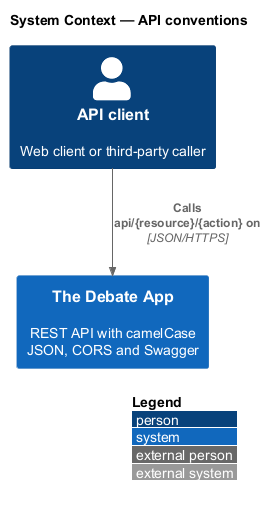
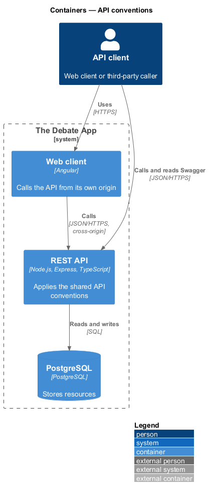
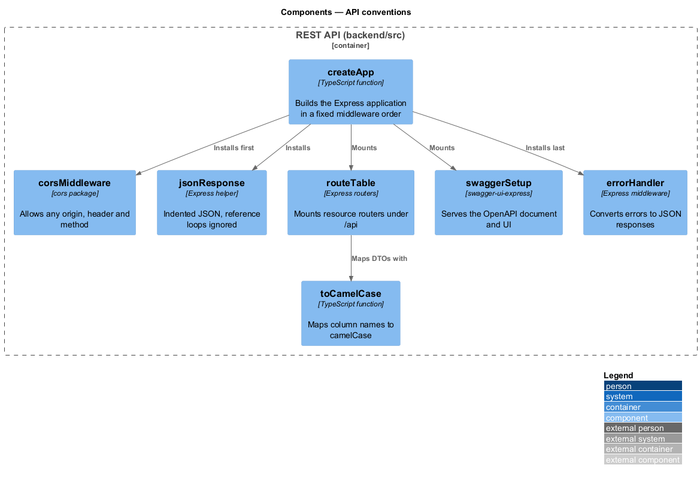
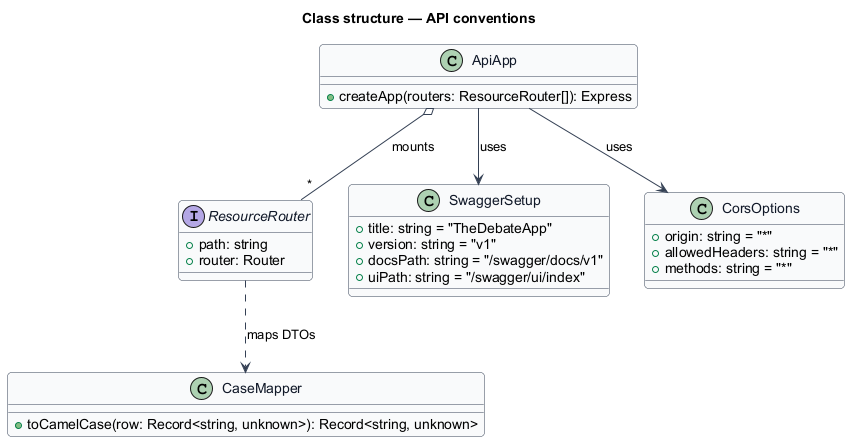
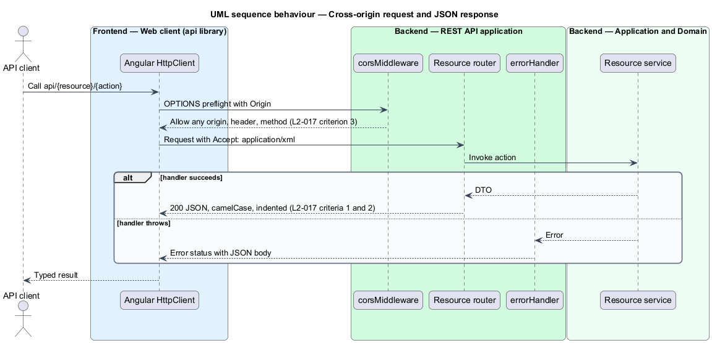
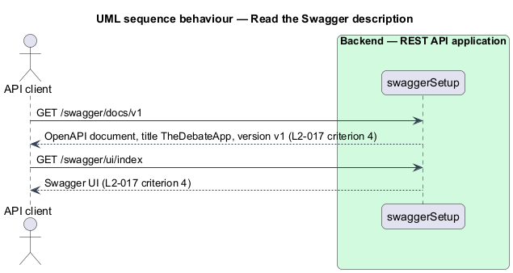

# API conventions

## Overview

The Debate App exposes one REST API to the Angular web client and to any third-party caller. This feature defines the conventions that every endpoint shares, so that a client written against one resource behaves the same against another.

**attribute-style route** — URL of the form `api/{resource}/{action}` mapped explicitly to a handler, for example `api/meeting/add`

**camelCase JSON** — JSON document whose property names start with a lower-case letter, for example `isDeleted`

**CORS** — cross-origin resource sharing; browser mechanism by which a server permits requests from pages hosted on other origins

The legacy implementation configured these conventions in one install method. The rewrite keeps the same intent in the Express application factory, so that no resource module repeats them.

## Description

The slice lives in `backend/src/app.ts`, `backend/src/middleware` and `backend/src/shared`.

- **`createApp`** — function in `backend/src/app.ts`. It builds the Express application and installs the cross-cutting middleware in a fixed order: CORS, JSON body parsing, resource routers, Swagger, error handler.
- **`corsMiddleware`** — the `cors` package configured with origin `*`, any request header and any method.
- **`jsonResponse`** — response helper that serialises with two-space indentation and ignores reference loops. Responses are always `application/json`; Express has no XML formatter, so `Accept: application/xml` receives JSON.
- **`toCamelCase`** — shared function in `backend/src/shared` that maps database column names such as `is_deleted` to `isDeleted` before a DTO is returned.
- **`routeTable`** — list of resource routers (`meetings`, `articles`, `architectures`, `users`, `digital-assets`) mounted under `/api`.
- **`swaggerSetup`** — serves the OpenAPI document titled `TheDebateApp`, version `v1`, at `/swagger/docs/v1` and the Swagger UI at `/swagger/ui/index`.
- **`errorHandler`** — middleware in `backend/src/middleware` that converts thrown errors into JSON error responses.

The legacy conventional route `api/{controller}/{id}` (criterion 5) and the SignalR mapping (criterion 6) have no stated purpose in the product overview. Whether the rewrite retains them is `<TO SUPPLY>`.

## Requirements

| L2 ID | Refines (L1) | Requirement |
|-------|--------------|-------------|
| `L2-017` | `L1-008` | Every API response shall be JSON with camelCase property names and indented formatting, and reference loops shall be ignored rather than raising an error. |
| `L2-017` | `L1-008` | A request with `Accept: application/xml` shall still receive a JSON response. |
| `L2-017` | `L1-008` | The API shall return CORS headers that allow any origin, header and method for a cross-origin request to any endpoint. |
| `L2-017` | `L1-008` | The API shall serve a Swagger document titled `TheDebateApp`, version `v1`, at `/swagger/docs/v1` and the Swagger UI at `/swagger/ui/index`. |
| `L2-017` | `L1-008` | Where attribute routes are mapped, the conventional route `api/{controller}/{id}` shall also resolve with `id` optional. Retention is `<TO SUPPLY>`. |
| `L2-017` | `L1-008` | The API shall map SignalR at its default path when the pipeline starts. Retention is `<TO SUPPLY>`. |

## Diagrams

### System context

An API client, such as the web client or a third-party caller, sends requests to The Debate App and reads the Swagger description.

### Containers

The web client calls the REST API from a different origin. The API reads and writes PostgreSQL, and this feature adds no database access of its own.

### Components

`createApp` installs CORS, JSON serialisation, the routers, Swagger and the error handler. The routers return DTOs that pass through `toCamelCase`.

### Class structure

`ApiApp` composes the middleware and the route table. `ResourceRouter` is the shape that every resource module implements.

### Behaviour — cross-origin request and JSON response

A browser on another origin sends a request. The API answers the preflight, runs the handler and returns camelCase JSON regardless of the `Accept` header (L2-017).

### Behaviour — read the Swagger description

A caller requests the OpenAPI document and the UI, both served by the API application (L2-017).

