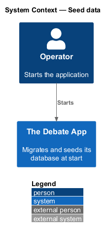
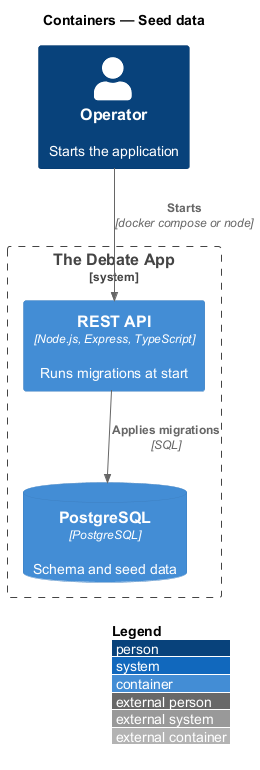
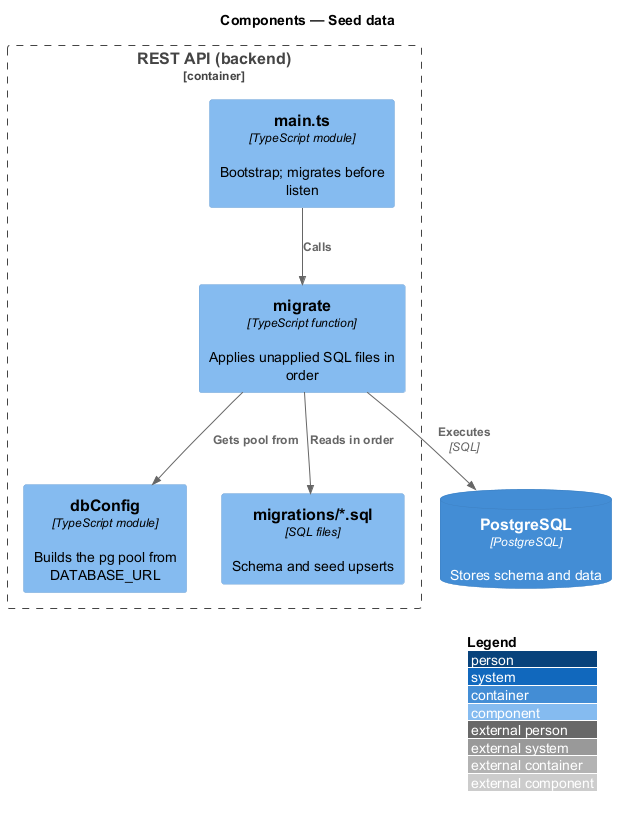
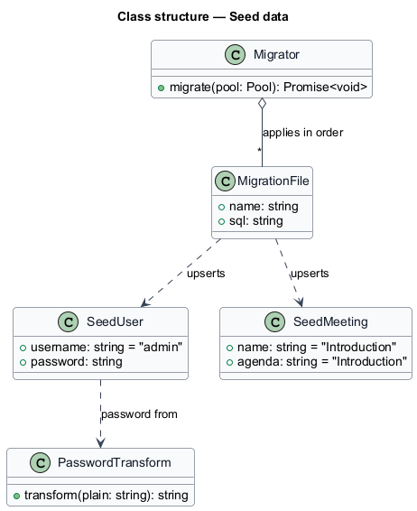
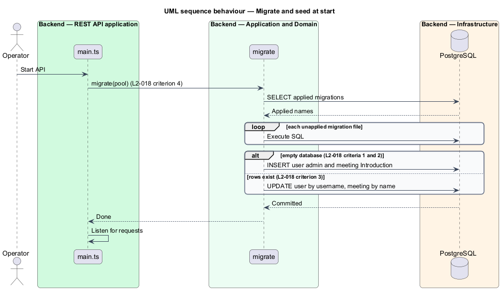

# Seed data

## Overview

A new Debate App database has no users and no meetings, so nobody can sign in and the meeting list is empty. Seeding creates the minimum data needed to use the application after first start.

**seed** — initial record inserted by a migration so that a fresh database is usable

**migration** — ordered SQL file that changes the database schema or data and is applied once

Seeding creates an administrative user and an introductory meeting. It is idempotent: running it again updates the existing records instead of duplicating them.

## Description

The slice lives in `backend/migrations` and `backend/src/config`.

- **`migrations/*.sql`** — ordered SQL files. The first creates the `users`, `roles`, `meetings` and related tables. A later file performs the seed.
- **`seed.sql`** — upserts the user with `username = 'admin'` and the meeting with `name = 'Introduction'`. Matching on those columns makes the script repeatable.
- **`passwordTransform`** — Base64 of the SHA-256 hash of the UTF-8 password, with no salt (L2-015). The seed computes the same value in SQL with `encode(sha256(convert_to('thegreatwpdebate','UTF8')),'base64')`.
- **`migrate`** — function in `backend/src/config` that applies unapplied migrations in order, called by `main.ts` before the server listens.
- **`dbConfig`** — reads `DATABASE_URL` from the environment and builds the `pg` pool. The legacy name `TheDebateAppDataContext` maps to this variable.

Roles attached to the admin user are `<TO SUPPLY>`. The admin password is a published default, so changing it before production use is `<TO SUPPLY>`.

## Requirements

| L2 ID | Refines (L1) | Requirement |
|-------|--------------|-------------|
| `L2-018` | `L1-009` | Seeding against an empty database shall create a user with `username = admin` and `password` equal to the transform of `thegreatwpdebate`. |
| `L2-018` | `L1-009` | Seeding against an empty database shall create a meeting with `name = Introduction` and `agenda = Introduction`. |
| `L2-018` | `L1-009` | Seeding shall match an existing user on `username` and an existing meeting on `name`, and shall update them rather than duplicate them. |
| `L2-018` | `L1-009` | The application shall migrate the schema automatically at start. |
| `L2-018` | `L1-009` | The data layer shall connect with the configured connection string and shall not use proxy creation or lazy loading. The connection setting in the rewrite is `DATABASE_URL`. |

## Diagrams

### System context

An operator starts The Debate App, which prepares its own database.

### Containers

The API container applies migrations to PostgreSQL before it listens for requests.

### Components

`main.ts` calls `migrate`, which runs the SQL files including the seed.

### Class structure

`Migrator` applies `MigrationFile` entries in order. `SeedUser` and `SeedMeeting` describe the seeded rows.

### Behaviour — migrate and seed at start

The API applies pending migrations, seeds on an empty database and updates the seed rows on a repeat run (L2-018).

