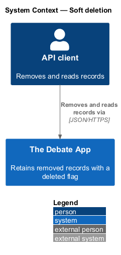
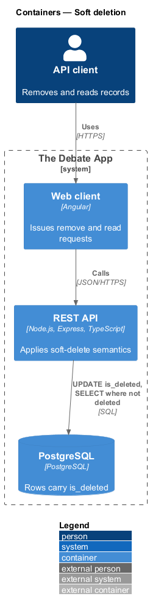
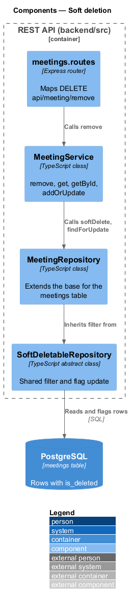
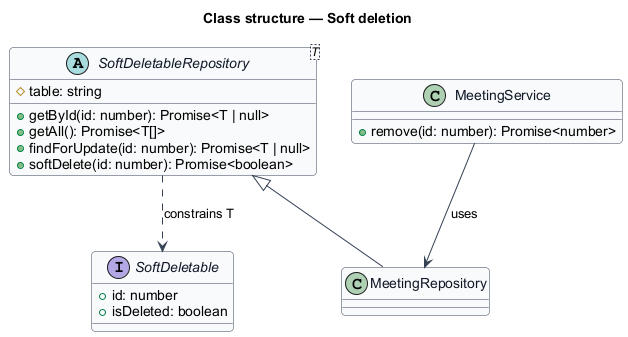
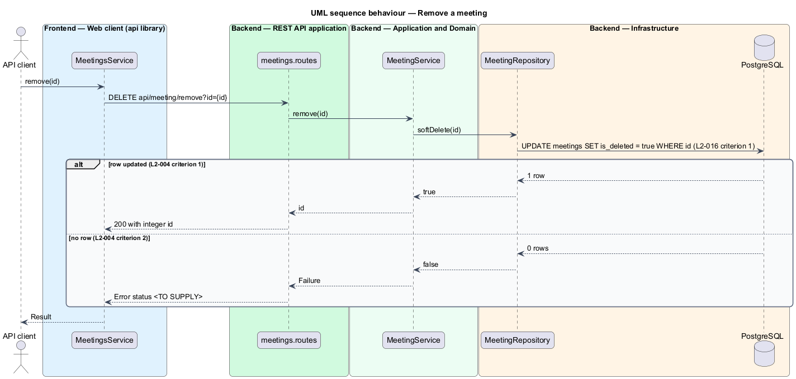
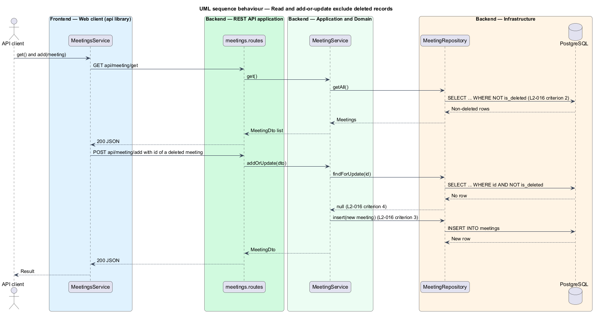

# Soft deletion

## Overview

The API never physically deletes a record. Removing a record marks it deleted, and every later read and every add-or-update match ignores it. This keeps history in the database while the product behaves as if the record is gone.

**soft deletion** — removal that sets an `is_deleted` flag to true and leaves the row in place

**add-or-update** — single operation that inserts a record when none matches the supplied `id` and overwrites the matching record otherwise

The pattern applies to meetings, articles, architectures, architecture items, users, digital assets, roles and invitation codes. The meeting `remove` endpoint (L2-004) is the reference case.

## Description

The slice lives in `backend/src/shared` and is reused by each resource repository.

- **`SoftDeletableRepository`** — abstract base class in `backend/src/shared`. It provides `getById`, `getAll`, `findForUpdate` and `softDelete`, each parameterised by table name.
- **`notDeleted`** — SQL fragment `is_deleted = false` appended to every read and every update-match query.
- **`softDelete`** — runs `UPDATE {table} SET is_deleted = true WHERE id = $1` and never issues `DELETE`.
- **`MeetingRepository`** and the other resource repositories — extend the base class and inherit the filter.
- **`meetings.routes`** — maps `DELETE api/meeting/remove?id={id}` to `MeetingService.remove` and returns the integer `id` as the body.

For an unknown `id`, the legacy endpoint failed with a server error (L2-004 criterion 2). The rewrite status code for that case is `<TO SUPPLY>`. The `getById` lookup returns null for an unknown id (L2-016 criterion 4).

## Requirements

| L2 ID | Refines (L1) | Requirement |
|-------|--------------|-------------|
| `L2-004` | `L1-001` | `DELETE api/meeting/remove?id={id}` shall set `is_deleted` to true on the meeting with the given `id`, save the change, and return HTTP 200 with the integer `id` as the body. |
| `L2-004` | `L1-007` | When no meeting with the given `id` exists, the request shall fail. The status code is `<TO SUPPLY>`. |
| `L2-016` | `L1-007` | A `remove` action shall leave the database row in place with `is_deleted = true`. |
| `L2-016` | `L1-007` | A `get` or `getById` call shall exclude every entity with `is_deleted = true`. |
| `L2-016` | `L1-007` | An add-or-update request carrying the `id` of a soft-deleted entity shall insert a new entity instead of updating the deleted one. |
| `L2-016` | `L1-007` | `getById` called with an unknown id shall return null. |

## Diagrams

### System context

An API client removes and reads records through The Debate App, which retains removed rows.

### Containers

The web client calls the REST API, which flags rows in PostgreSQL instead of deleting them.

### Components

The resource router calls the service, which uses a repository derived from `SoftDeletableRepository`.

### Class structure

`SoftDeletableRepository` centralises the filter and the flag update. Each resource repository extends it.

### Behaviour — remove a meeting

The remove action flags the row and returns the `id`; the alternate path covers an unknown `id` (L2-004).

### Behaviour — read and add-or-update exclude deleted records

Reads filter on the flag, and an add-or-update with a deleted `id` inserts a new row (L2-016).

