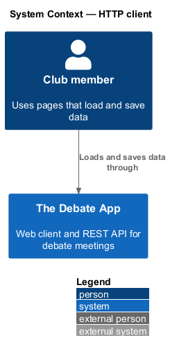
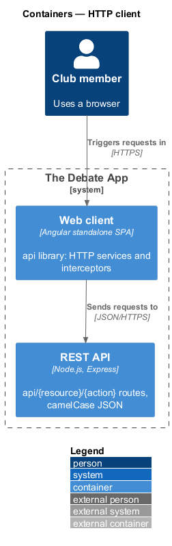
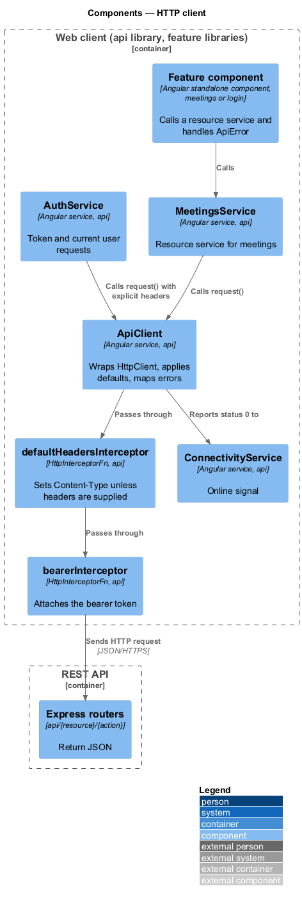
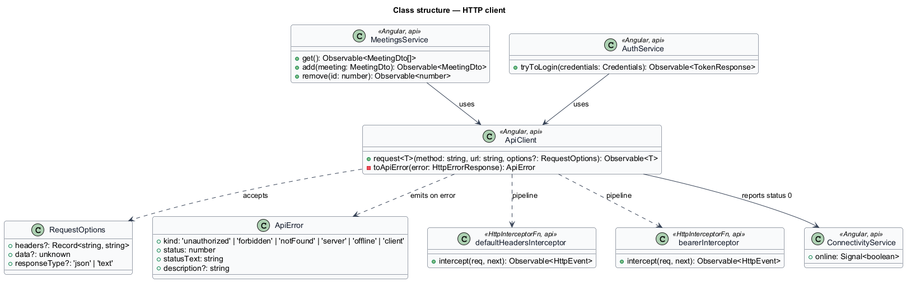
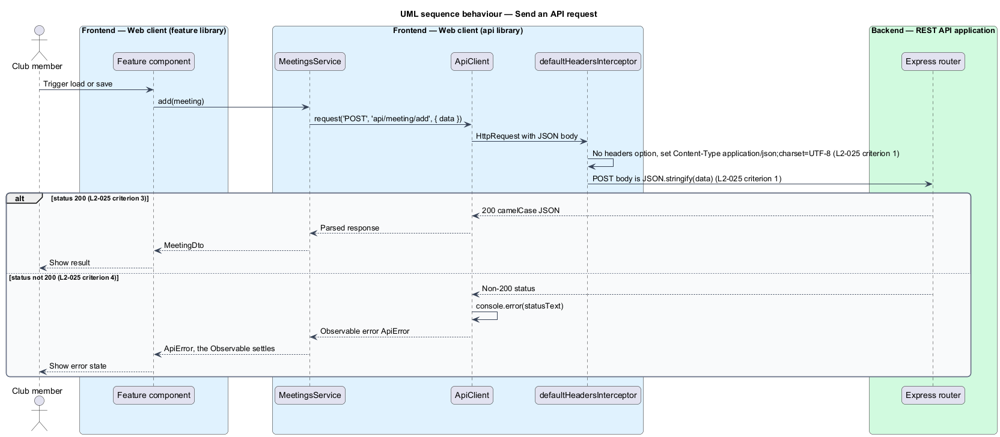
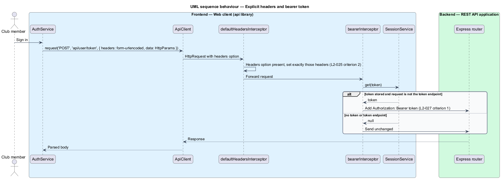
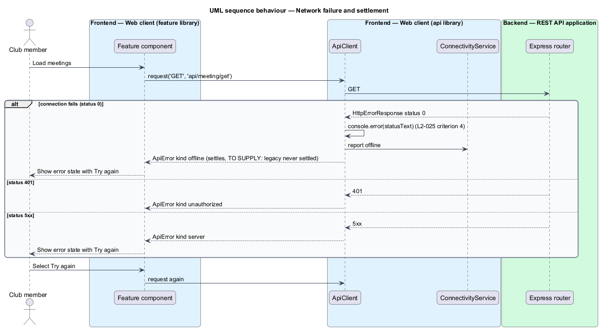

# HTTP client

## Overview

Every page of the web client talks to the REST API through one HTTP layer. This feature defines that layer: how requests are built, which headers are sent by default, how responses are returned, and how failures are reported to the calling page.

**api library** — Angular library project `@the-debate-app/api` that holds DTO models, HTTP services, interceptors and the session service, and no components

**ApiError** — typed error value that an HTTP service emits when a response has a non-success status or no response arrives

The legacy client wrapped `XMLHttpRequest` in `utilities/fetch.ts`. It set a JSON content type by default, accepted a `headers` option that replaced the default headers, resolved a promise with the response text for status 200, and logged the status text for any other status without ever settling the promise. A page that awaited such a request stayed in its loading state indefinitely (L1-011, L1-012).

The Angular design replaces the wrapper with `HttpClient`, functional interceptors and one `Observable` per call.

The mocks define the failure states that this layer feeds: `pages/meetings` (loading, error), `pages/meeting` (loading, error), `pages/meeting-edit` and `pages/meeting-create` (error, submitting), `pages/sign-in` (error), `pages/server-error`, `pages/offline`, `pages/forbidden` and the `notifications/banner` danger and persistent states.

### Mock coverage

| Mock | States fed by this feature | Failure kind |
|------|----------------------------|--------------|
| `pages/meetings`, `pages/meeting`, `pages/meeting-edit` | loading, error | `server`, `offline` |
| `pages/meeting-edit`, `pages/meeting-create` | submitting, error | `server`, `offline` |
| `pages/sign-in` | submitting, error | `offline` |
| `pages/forbidden` | default | `unauthorized` |
| `pages/server-error`, `pages/offline` | default | `server`, `offline` |
| `notifications/banner` | danger, persistent | `offline` |

## Description

The slice lives in the `api` library, `projects/api/src/lib`. Feature libraries call its services; the library imports no component and no feature project.

- **`ApiClient`** — service in `services`. `request<T>(method, url, options)` wraps `HttpClient` and returns `Observable<T>`. `RequestOptions` carries `headers`, `data` and `responseType`.
  - Without a `headers` option the request carries `Content-Type: application/json;charset=UTF-8` and the body is `JSON.stringify(data)` (L2-025 criterion 1).
  - With a `headers` option the request carries exactly those headers (L2-025 criterion 2).
  - A success response emits the response body. The legacy criterion names status 200 and raw response text (L2-025 criterion 3). `HttpClient` treats every 2xx status as success and parses JSON. Whether only status 200 is a success and whether the body stays unparsed is `<TO SUPPLY>`. `responseType: 'text'` is available for the asset serve endpoint.
  - A non-success response logs the status text to `console.error` (L2-025 criterion 4) and emits an `ApiError` through the observable error channel.
- **`defaultHeadersInterceptor`** — `HttpInterceptorFn` in `interceptors`. It applies the default `Content-Type` when the call supplied no headers.
- **`bearerInterceptor`** — `HttpInterceptorFn` in `interceptors`, described in the `sign-in` design. It runs after the defaults and adds the bearer token.
- **Resource services** — `MeetingsService`, `ArticlesService`, `ArchitecturesService`, `UsersService`, `DigitalAssetsService` and `AuthService` in `services`, one per resource. Each service builds the URL `api/{resource}/{action}` and calls `ApiClient`. Components never call `HttpClient`.
- **`ApiError`** — model in `models`. `kind` is one of `unauthorized` (401), `forbidden` (403), `notFound` (404), `server` (5xx), `offline` (status 0) and `client` (other 4xx). `description` carries the OAuth `error_description` when present.
- **`ConnectivityService`** — receives status 0 reports from `ApiClient` and listens to `window` online events. The shell uses it for the banner (see `route-and-navigate`).
- **Providers** — the shell registers `provideHttpClient(withInterceptors([defaultHeadersInterceptor, bearerInterceptor]))`. The base URL comes from an injection token `API_BASE_URL`; its value per environment is `<TO SUPPLY>`.

### Decision — the promise that never settles

L2-025 criterion 4 records that a non-200 response is logged and that the promise never settles. The criterion is an observed defect, and no L1 or L2 requirement asks for a request that never completes. The mocks show an `error` state with `Try again` for every data page, which is reachable only if a failed request completes. The design therefore emits an `ApiError` on the observable error channel so that every call settles. The `console.error` log is kept. The decision is `<TO SUPPLY>` for confirmation against L2-025 criterion 4, which L2 would need to restate as "the observable shall emit an error".

### Other open items

- **Retries.** Automatic retry of a failed request is not specified. The design performs none; the `Try again` control repeats the call. A retry policy for idempotent `GET` calls is `<TO SUPPLY>`.
- **Timeouts.** No request timeout is specified. The value is `<TO SUPPLY>`.
- **Error body.** The API validates nothing and returns no error envelope except the OAuth error. The shape of a server error body is `<TO SUPPLY>`.
- **Cache.** The serve endpoint is cached by the server (L2-012). The client adds no cache.

## Requirements

| L2 ID | Refines (L1) | Requirement |
|-------|--------------|-------------|
| `L2-025` | `L1-011`, `L1-012` | The client HTTP layer shall set `Content-Type: application/json;charset=UTF-8` and shall send `data` as `JSON.stringify(data)` when no `headers` option is given. It shall set exactly the supplied headers when a `headers` option is given. It shall resolve with the raw response text when the response status is 200. When the response status is not 200 it shall log the status text to `console.error` and the promise shall never settle *(observed)*. |

## Diagrams

### System context

Pages in the web client load and save data through the REST API.

### Containers

The HTTP layer is part of the web client and sends JSON over HTTPS to the REST API.

### Components

Resource services call `ApiClient`, which passes each request through two interceptors. `ApiClient` reports status 0 to `ConnectivityService`.

### Class structure

`ApiClient` accepts `RequestOptions` and emits `ApiError`. Resource services depend on `ApiClient`.

### Behaviour — send an API request

The default header interceptor applies L2-025 criterion 1. A 200 response resolves the call. Any other status logs and emits an `ApiError`.

### Behaviour — explicit headers and bearer token

A call with a `headers` option sends exactly those headers (L2-025 criterion 2). The bearer interceptor then adds the token when one is stored.

### Behaviour — network failure and settlement

Offline, unauthorised and server failures each emit an `ApiError`, so the page leaves its loading state and can offer `Try again`.

