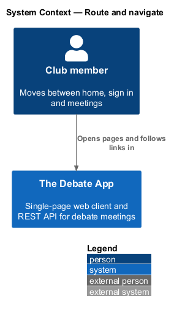
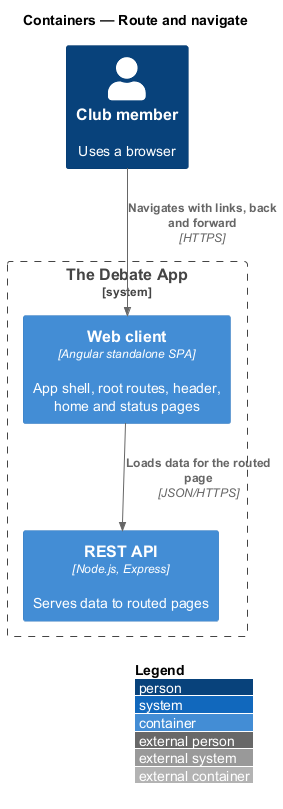
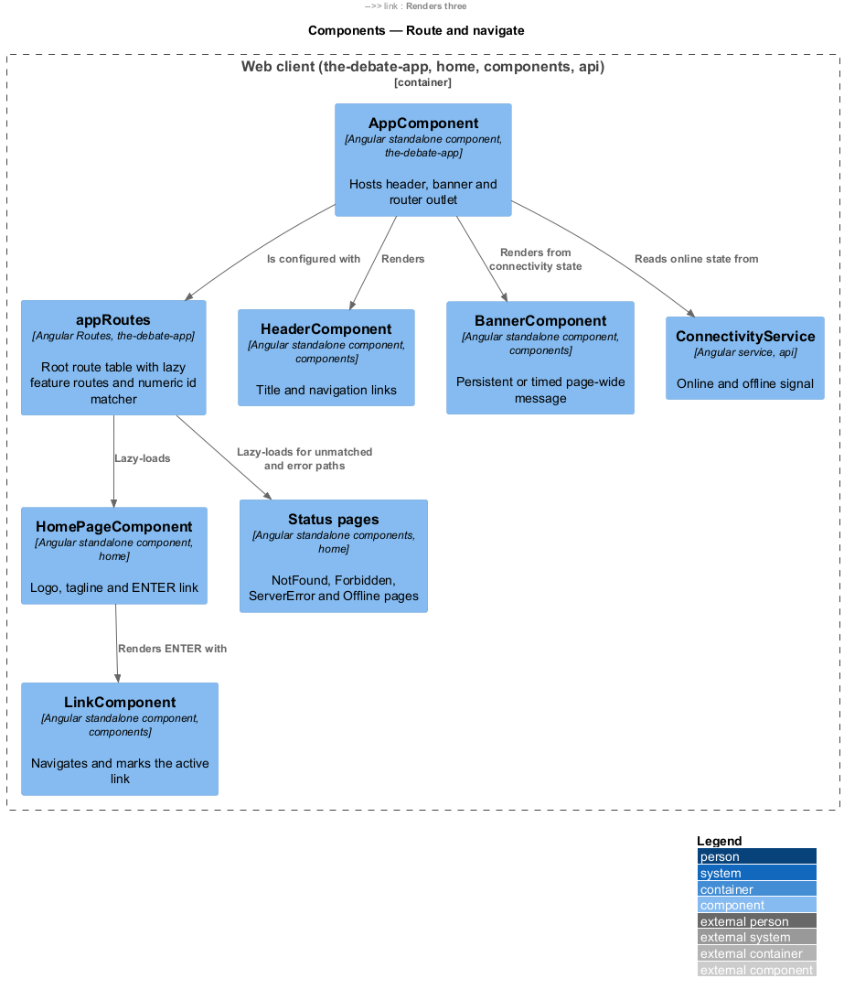
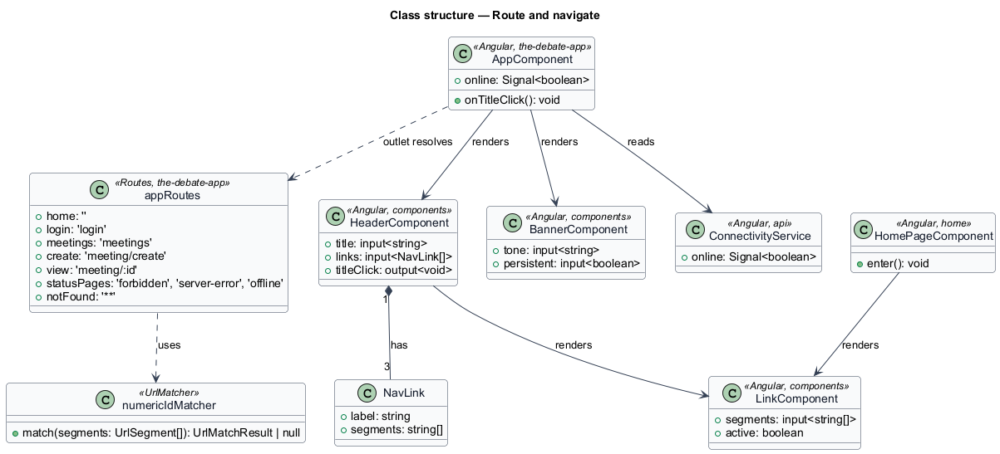
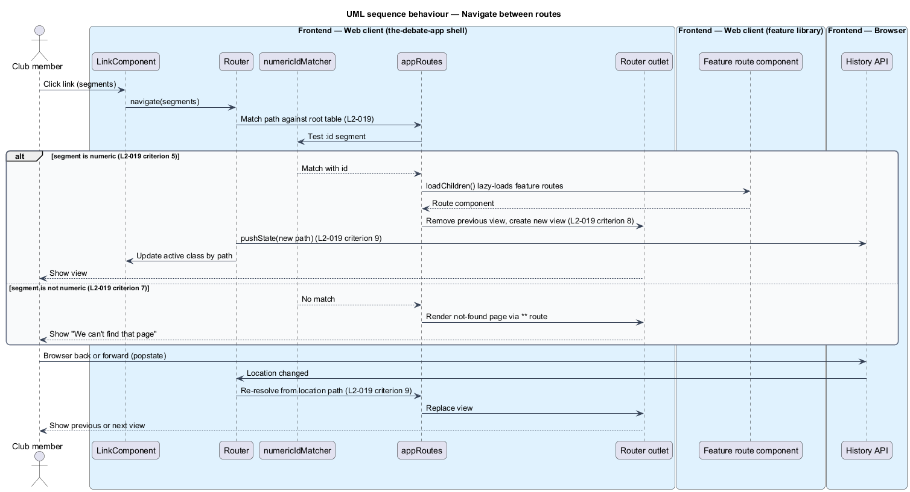
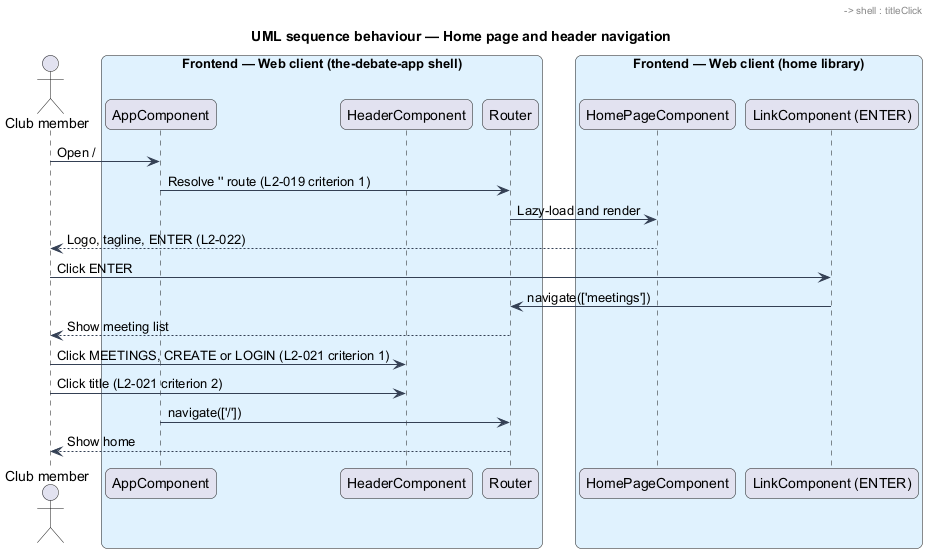
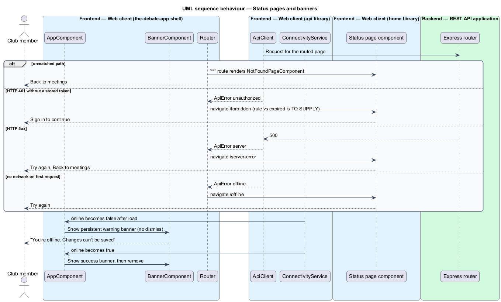

# Route and navigate

## Overview

The Debate App is a single-page web client. A *route* is a URL path that selects one view. This feature covers the route table, the shell that hosts the active view, the header, the home page, and the pages and banners that report a problem with navigation or connectivity.

**app shell** — Angular application project that bootstraps the client, hosts the header, banner and router outlet, and lazy-loads the feature projects

**router outlet** — placeholder in the shell that displays exactly one routed view at a time

The legacy client resolved paths with a hand-written router and removed the previous child of `#router-outlet` on every change. The Angular design keeps the intent: one view at a time, browser history kept in sync, and the active navigation link kept in sync with the path (L1-010).

The mocks `pages/home`, `pages/not-found`, `pages/forbidden`, `pages/server-error`, `pages/offline` and the `notifications/banner` set define the visible states.

### Mock coverage

| Mock | States covered | Notes |
|------|----------------|-------|
| `pages/home` | default | Tagline and Enter button |
| `pages/not-found` | default | Header shown, Back to meetings |
| `pages/forbidden` | default | Sign in needed after a 401 |
| `pages/server-error` | default | Try again, Back to meetings |
| `pages/offline` | default | First request failed with no network |
| `notifications/banner` | info, success, warning, danger, persistent | Page-wide message above the header |

## Description

The slice lives in the `the-debate-app` application, the `home` feature library, the `components` library and the `api` library, following the dependency rules in `AGENTS.md`: `the-debate-app` depends on feature projects, feature projects depend on `components` and `api`, and no other dependency exists.

- **`AppComponent`** — shell component in `projects/the-debate-app/src/app`. It renders `HeaderComponent`, `BannerComponent` and `<router-outlet>`. It contains no feature logic.
- **`appRoutes`** — route table in `projects/the-debate-app/src/app/app.routes.ts`. Each feature entry uses `loadChildren` to import the feature library's routes through its `public-api.ts`.
  - `''` loads `HOME_ROUTES` from `@the-debate-app/home`.
  - `login` loads `LOGIN_ROUTES` from `@the-debate-app/login`.
  - `meetings`, `meeting/create` and `meeting/:id` load `MEETINGS_ROUTES` from `@the-debate-app/meetings`.
  - `forbidden`, `server-error`, `offline` and `**` load the status pages.
- **`numericIdMatcher`** — `UrlMatcher` that matches `meeting/{n}` only when `{n}` consists of digits, so a non-numeric segment falls through to the `**` route (L2-019 criterion 7).
- **`HeaderComponent`** — presentational component in `projects/components/src/lib/header`. It takes `title` and `links` inputs and emits `titleClick`. The shell passes three links: `MEETINGS` to `/meetings`, `CREATE` to `/meeting/create` and `LOGIN` to `/login`.
- **`LinkComponent`** — presentational component in `projects/components/src/lib/link`. It wraps `routerLink` and `routerLinkActive` so the `active` class tracks the current path.
- **`BannerComponent`** — presentational component in `projects/components/src/lib/banner`. It takes `tone` and `persistent` inputs. A persistent banner has no dismiss control. The folder is an addition to the component list in `AGENTS.md` and is `<TO SUPPLY>` for confirmation.
- **`HomePageComponent`** — smart component in `projects/home/src/lib`, routed by `home.routes.ts`. It renders the logo, the tagline and a `LinkComponent` labelled `ENTER`.
- **Status pages** — `NotFoundPageComponent`, `ForbiddenPageComponent`, `ServerErrorPageComponent` and `OfflinePageComponent`. Their project is `<TO SUPPLY>`. The `home` library is the proposed owner because `AGENTS.md` lists no further project for these pages, and the shell shall not contain feature logic.
- **`ConnectivityService`** — service in `projects/api/src/lib/services`. It exposes `online` as a signal driven by `window` `online` and `offline` events and by failed requests with status 0. The shell reads it to show the persistent offline banner and the success banner on recovery.

Router configuration uses `withComponentInputBinding()` so a routed component receives `id` as an input. The Angular `Router` and `Location` services perform the `history.pushState` and `popstate` work that the legacy router coded by hand (L2-019 criterion 9). Criterion 10, immediate replay of the current route to a late listener, maps to `Router.url` and the router `events`, which expose the current state to a late subscriber.

Open items:

- **Edit route.** The mocks use `/meeting/:id` for the read-only view and `/meeting/:id/edit` for the form, while L2-019 criterion 5 maps `/meeting/{n}` to the edit view. The reconciliation is `<TO SUPPLY>` (mocks question 1).
- **`/meeting/{n}/updateminutes`.** L2-019 criterion 6 records a legacy defect. The design routes the path to `**` and renders the not-found page. The decision is `<TO SUPPLY>` for confirmation.
- **Header title.** L2-021 criterion 1 specifies the heading `Architecture`. The mocks show `The Debate App` (mocks question 4). The final text is `<TO SUPPLY>`.
- **Header contents.** The mocks show the links `Meetings` and `New meeting` and an account avatar, where L2-021 specifies `MEETINGS`, `CREATE` and `LOGIN`. The avatar belongs to the `sign-in` design. The label casing and the `LOGIN` link while signed in are `<TO SUPPLY>`.
- **Logo.** L2-022 specifies an `img` with `src="/src/images/logo.jpg"`. The home mock shows a title and tagline without an image. The asset path in the Angular build is `<TO SUPPLY>`.
- **Home Enter and sign-in.** The home mock note states that the meeting list redirects to sign in when the token is missing. L2-002 makes the list anonymous. The behaviour is `<TO SUPPLY>`.
- **Forbidden versus expired.** The forbidden page and the sign-in `expired` state both follow a 401. The rule that chooses between them is `<TO SUPPLY>`.

## Requirements

| L2 ID | Refines (L1) | Requirement |
|-------|--------------|-------------|
| `L2-019` | `L1-010` | The client shall render the home view at `/`, the login view at `/login`, the meeting list at `/meetings`, the create view at `/meeting/create` and the edit view at `/meeting/{n}` for numeric `{n}`. The route `/meeting/{n}/updateminutes` shall resolve without rendering a view *(observed: the legacy outlet throws)*. A non-numeric `:id` segment shall not match. The client shall remove the previous view before rendering the new view, shall call `history.pushState` with the new path, shall re-resolve the route from `window.location.pathname` on `popstate`, and shall invoke a late listener immediately with the current route and params. |
| `L2-021` | `L1-010`, `L1-013` | The header shall show an `h2` with text `Architecture` and links labelled `MEETINGS` (to `/meetings`), `CREATE` (to `/meeting/create`) and `LOGIN` (to `/login`). A click on the `h2` shall navigate to `/`. |
| `L2-022` | `L1-010` | The home page shall contain an `img` with `src="/src/images/logo.jpg"` and a link labelled `ENTER` that navigates to `/meetings`. |

## Diagrams

### System context

A club member reaches every page through the single web client; no external system is involved.

### Containers

The web client resolves routes locally and calls the REST API only for the data of the routed page.

### Components

The shell composes the header, banner and outlet. The route table lazy-loads the home feature and the status pages.

### Class structure

`appRoutes` references `numericIdMatcher`. `HeaderComponent` owns three `NavLink` values and renders `LinkComponent`. `AppComponent` reads `ConnectivityService`.

### Behaviour — navigate between routes

A link click navigates, the router matches the path, lazy-loads the feature, replaces the view and pushes history. A non-numeric id falls through to not-found. Back and forward re-resolve from the location (L2-019).

### Behaviour — home page and header

The home page offers ENTER. The header offers three links and a title that navigates to `/` (L2-021, L2-022).

### Behaviour — status pages and banners

Unmatched paths, authorisation failures, server errors and loss of connectivity each lead to one status page or banner.

