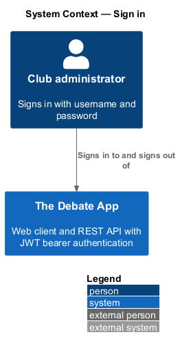
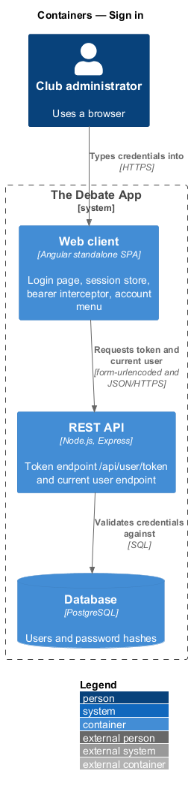
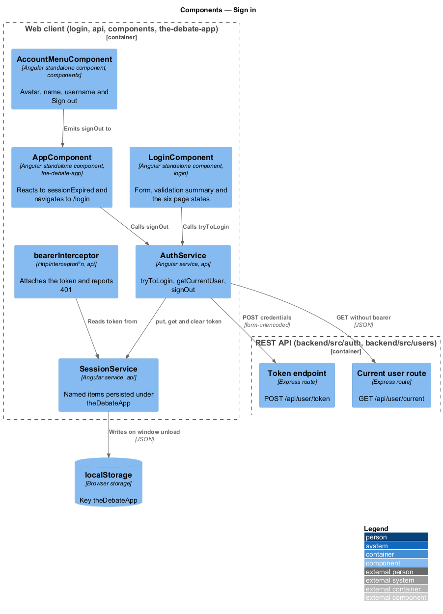
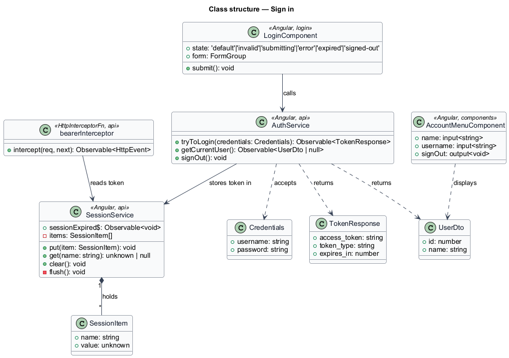
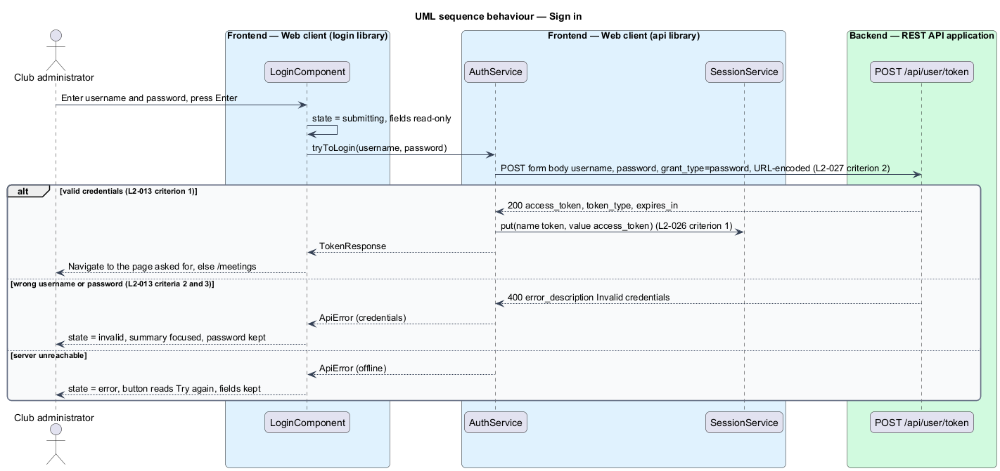
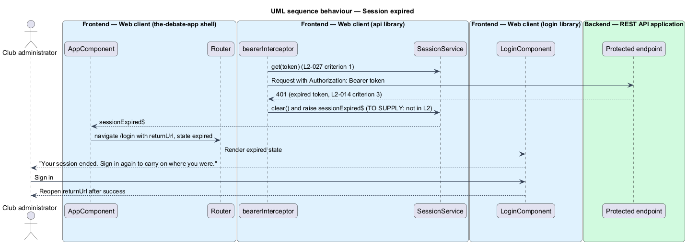
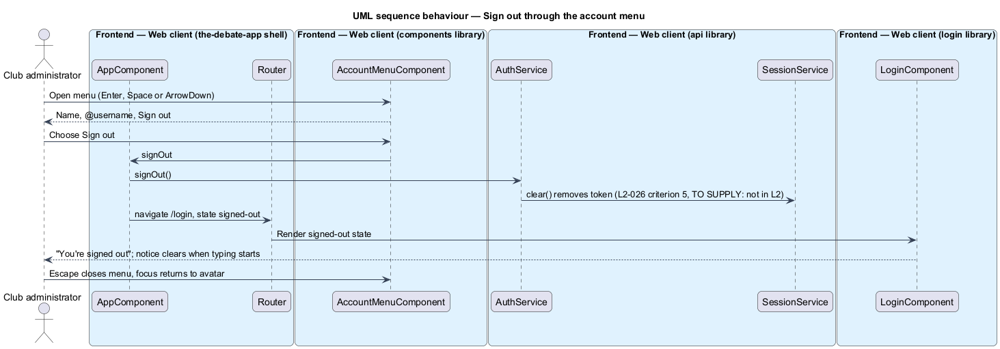
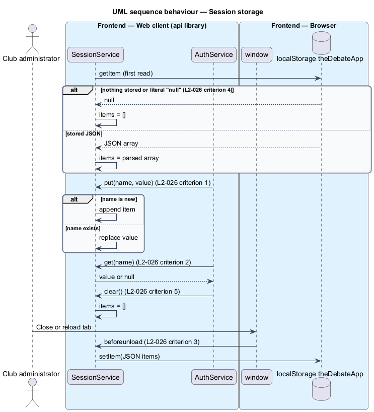

# Sign in

## Overview

The Debate App protects some API endpoints with a JSON Web Token (JWT). A *session* is the token that the browser keeps after a successful sign in. This feature covers the login page, the browser store that keeps the token, the interceptor that attaches the token to requests, the account menu, and the sign-out and session-expiry paths.

**session store** — named key/value list that the web client persists in browser local storage under the single key `theDebateApp`

**token endpoint** — `POST /api/user/token`, an OAuth2 resource-owner-password endpoint that returns `access_token`, `token_type` and `expires_in` (L2-013)

The legacy client had a login page without handlers and a `tryToLogin` method that nothing called (L1 "Not Implemented"). The design wires them together as L1-012 intends: store the token, attach it to authenticated requests, and let the user sign in.

The mocks `pages/sign-in`, `pages/forbidden`, `dialogs/account-menu` and the `notifications/banner` warning define the visible states.

### Mock coverage

| Mock | States covered | Notes |
|------|----------------|-------|
| `pages/sign-in` | default, invalid, submitting, error, expired, signed-out | Username and password form; loading and empty are not applicable |
| `pages/forbidden` | default | Sign in needed after a 401 (route and rule in `route-and-navigate`) |
| `dialogs/account-menu` | default | Avatar menu with name, username and Sign out |
| `notifications/banner` | warning | "Your session ends in 5 minutes", with Stay signed in |

## Description

The slice spans the `login` feature library, the `api` library, the `components` library and the shell. `login` composes `components` and calls `api`. `api` and `components` do not import each other, so the shell connects them: the shell passes the signed-in user to the header and handles `signOut` and `sessionExpired$`.

- **`LoginComponent`** — smart component in `projects/login/src/lib`, routed at `/login` by `login.routes.ts`. It holds a reactive form for `username` and `password` and a `state` of `default`, `invalid`, `submitting`, `error`, `expired` or `signed-out`.
  - `submitting` makes the fields read-only, not disabled, and shows `Signing in…` on the button.
  - `invalid` shows a summary titled `We couldn't sign you in`, focuses it, links to the password field and keeps the password.
  - `error` applies to a network failure, shows `We couldn't reach the server`, keeps the details and relabels the button `Try again`.
  - `expired` shows `Your session ended` and reopens the page the person was on after sign in.
  - `signed-out` shows `You're signed out` and clears when typing starts.
- **`AuthService`** — service in `projects/api/src/lib/services`.
  - `tryToLogin({ username, password })` sends `POST /api/user/token` with `Content-Type: application/x-www-form-urlencoded` and body `username={u}&password={p}&grant_type=password`, URL-encoded with spaces as `+` (L2-027 criterion 2). It builds the body with `HttpParams` and passes explicit headers, which the `http-client` design sends unchanged.
  - `getCurrentUser()` sends `GET /api/user/current` with the default JSON headers and no bearer token (L2-027 criterion 3). An empty body maps to `null`.
  - `signOut()` clears the stored token.
- **`SessionService`** — service in `projects/api/src/lib/storage`. It keeps `SessionItem` values in memory and implements `put`, `get` and `clear` (L2-026). The first read treats an absent value or the literal string `"null"` as an empty list. A `beforeunload` handler writes the list as JSON under `theDebateApp`. `pagehide` as an additional flush trigger is `<TO SUPPLY>`.
- **`bearerInterceptor`** — `HttpInterceptorFn` in `projects/api/src/lib/interceptors`. It adds `Authorization: Bearer {token}` when the store holds a `token` item (L2-027 criterion 1). The legacy client attached the header only to user CRUD requests. Whether the interceptor adds it to every `api/` request except the token endpoint, or only to user requests, is `<TO SUPPLY>`. A 401 response clears the token and emits `sessionExpired$`.
- **`AccountMenuComponent`** — presentational component in `projects/components/src/lib/account-menu`. It takes `name` and `username` inputs and emits `signOut`. It opens with Enter, Space or ArrowDown, moves with arrow keys, and closes with Escape while returning focus to the avatar. The folder is an addition to the component list in `AGENTS.md` and is `<TO SUPPLY>` for confirmation.
- **Shell wiring** — `AppComponent` calls `AuthService.getCurrentUser()` after the token is present, passes the result to the header, and navigates to `/login` on `sessionExpired$` and after `signOut`.

Assumptions in the mocks that the specs do not cover (mocks question 2):

- **Sign out.** The mocks assume Sign out clears the stored token (L2-026 criterion 5) and opens sign in in its `signed-out` state. L2 has no sign-out requirement. The entry is `<TO SUPPLY>`.
- **Session expired.** The mocks assume a 401 after the 120-minute token (L2-013) reopens sign in in its `expired` state and returns the person to the previous page. L2-014 specifies the 401 only. The entry is `<TO SUPPLY>`.
- **Expiry warning.** The warning banner announces expiry five minutes ahead and offers Stay signed in. The API has no refresh endpoint and the token carries `exp` only. The behaviour is `<TO SUPPLY>`.
- **Account menu.** The menu is in neither L1 nor L2. It refines `L2-009` (current user) and `L2-026` in the coverage matrix of the mocks.
- **Invalid-credentials message.** L2-013 criteria 2 and 3 return the same OAuth description `Invalid credentials`. The page text `Username or password is wrong.` is a mock decision.

## Requirements

| L2 ID | Refines (L1) | Requirement |
|-------|--------------|-------------|
| `L2-026` | `L1-012` | The store `Store` shall be registered under the key `theDebateApp`. `put({ name, value })` shall append an item for a new name and replace the value for an existing name. `get({ name })` shall return the matching item's value or null. The store shall write the items array to `localStorage` under the store key as JSON when the window unloads. The store shall start with an empty array when `localStorage` holds the literal string `"null"` or nothing under the key. `clear()` shall leave the array empty. |
| `L2-027` | `L1-012` | After a token is stored under name `token`, the user requests `get`, `getById`, `add` and `remove` shall carry `Authorization: Bearer {token}` and `Content-Type: application/json;charset=UTF-8`. `tryToLogin({ username, password })` shall send `POST /api/user/token` with `Content-Type: application/x-www-form-urlencoded` and body `username={u}&password={p}&grant_type=password` (URL-encoded, spaces as `+`). `getCurrentUser()` shall send `GET /api/user/current` with the default JSON headers and no bearer token. |

## Diagrams

### System context

The administrator signs in to The Debate App; no external identity provider is involved.

### Containers

The web client posts credentials to the REST API, which validates them against the database users.

### Components

`LoginComponent` calls `AuthService`, which uses `SessionService` and the token endpoint. The interceptor reads the token and reports a 401 to the shell.

### Class structure

`SessionService` holds `SessionItem` values. `AuthService` stores the token and returns `TokenResponse` and `UserDto`. `LoginComponent` carries the six page states.

### Behaviour — sign in

The form posts URL-encoded credentials. Success stores the token. Wrong credentials show the invalid state. A network failure shows the error state (L2-027).

### Behaviour — session expired

A 401 clears the token and routes to the expired state of sign in, with a return URL.

### Behaviour — sign out

The account menu emits `signOut`. The token is cleared and sign in opens in the signed-out state.

### Behaviour — session storage

The store reads local storage once, supports put, get and clear, and writes on unload (L2-026).

