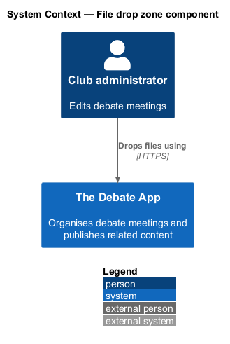
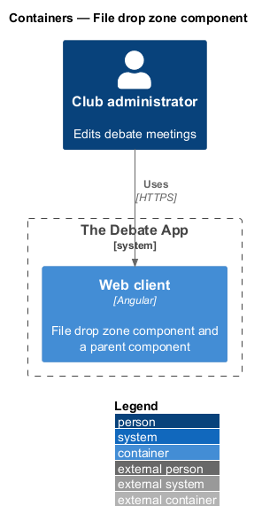
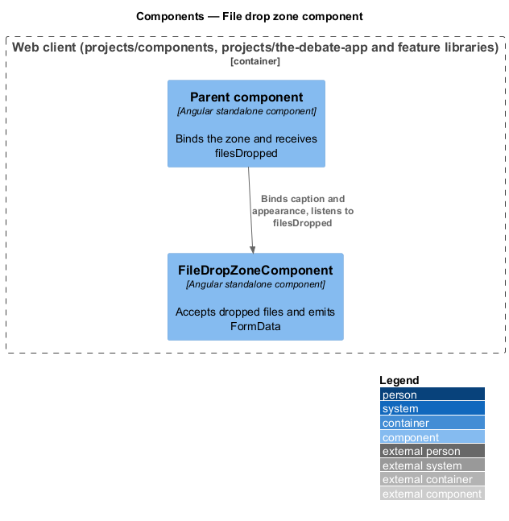
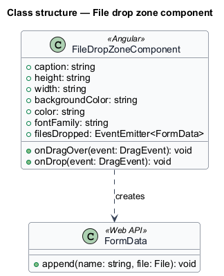
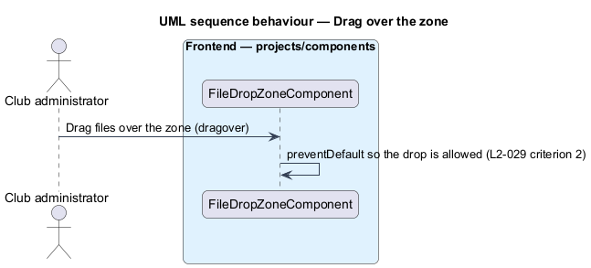
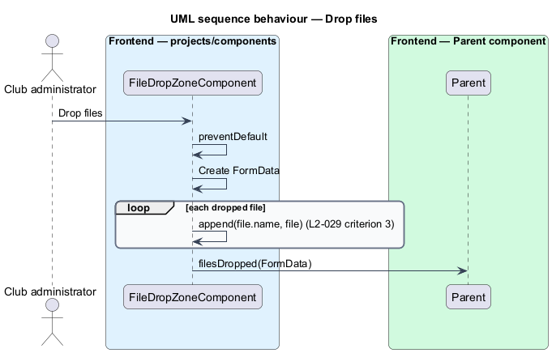
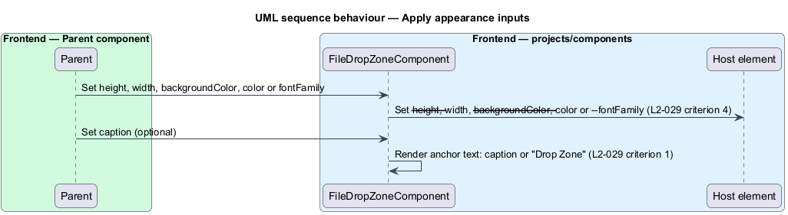

# File drop zone component

## Overview

The rich-text editors offer an image button. Choosing an image is meant to open a dialog with a drop target for files. This feature covers the reusable file drop zone that raises the dropped files.

**drop zone** — region that accepts files dragged onto it

**caption** — text shown inside the drop zone

The drop zone shows an anchor with a caption. A dropped set of files leaves the component as one `FormData` value. The component does not upload anything.

Its use is deferred. `docs/mocks/README.md` (question 3) records that the insert-image dialog, which would hold the drop zone and upload to `/api/digitalasset/upload` (L2-011), is not mocked. The visuals of the drop zone, its drag-over state and its error state are `<TO SUPPLY>`.

## Description

The component lives in `frontend/projects/components/src/lib/file-drop-zone`. It is presentational: inputs and outputs only, no HTTP call, and no import from `projects/api` or any feature project. The consumer passes the `FormData` to a service in `projects/api`.

- **`FileDropZoneComponent`** — standalone component. Inputs: `caption`, `height`, `width`, `backgroundColor`, `color`, `fontFamily`. Output: `filesDropped` (`FormData`). The legacy event name was `[Drop Zone] Drop` with `detail.files`.
- **Caption** — the anchor text is `caption`, or `Drop Zone` when no caption is set.
- **Drag over** — the `dragover` handler prevents the default so the drop is allowed.
- **Drop** — the `drop` handler builds a `FormData` and appends each file under its own file name. Two files with the same name collide under that key; the handling is `<TO SUPPLY>`.
- **Appearance** — a change to an appearance input sets the matching custom property on the host: `--height`, `--width`, `--backgroundColor`, `--color`, `--fontFamily`. The mapping uses host style bindings.
- **Keyboard access** — the anchor should open a file picker on activation so keyboard users have an alternative to dragging. L2-029 does not state this. It is `<TO SUPPLY>`.

## Requirements

| L2 ID | Refines (L1) | Requirement |
|-------|--------------|-------------|
| `L2-029` | `L1-013` | `ce-drop-zone` is a shadow-DOM file drop target. 1. Given `ce-drop-zone` renders, when inspected, then it shows an anchor whose text is the `caption` attribute or `Drop Zone` when no caption is set. 2. Given files are dragged over the zone, when `dragover` fires, then the default is prevented so the drop is allowed. 3. Given files are dropped, when `drop` fires, then a `[Drop Zone] Drop` custom event is dispatched whose `detail.files` is a `FormData` containing each file appended under its own file name. 4. Given the attributes `height`, `width`, `background-color`, `color`, or `font-family` are set, when changed, then the CSS custom properties `--height`, `--width`, `--backgroundColor`, `--color`, or `--fontFamily` on the host are set to the new value. |

## Diagrams

### System context

A club administrator drops files onto the zone. No page uses the zone yet.

### Containers

The drop zone runs inside the Angular web client only. The upload call to the API is deferred and sits outside this feature.

### Components

A parent component binds `FileDropZoneComponent` and receives `filesDropped`.

### Class structure

`FileDropZoneComponent` builds a `FormData` from the dropped `FileList`.

### Behaviour — drag over the zone

The `dragover` handler prevents the default (L2-029 criterion 2).

### Behaviour — drop files

The `drop` handler appends each file to a `FormData` and emits it (L2-029 criterion 3).

### Behaviour — apply appearance inputs

Appearance inputs become host custom properties, and the caption defaults to `Drop Zone` (L2-029 criteria 1 and 4).

