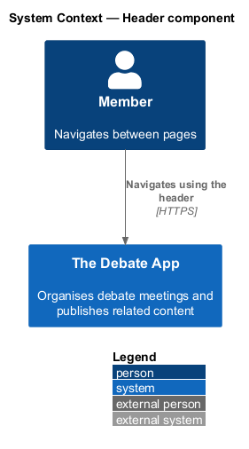
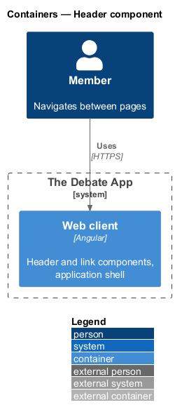
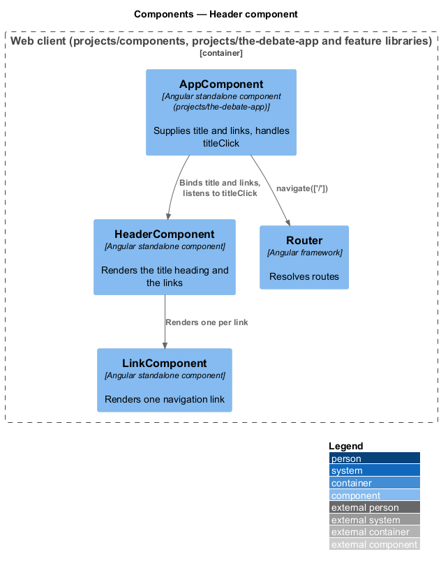
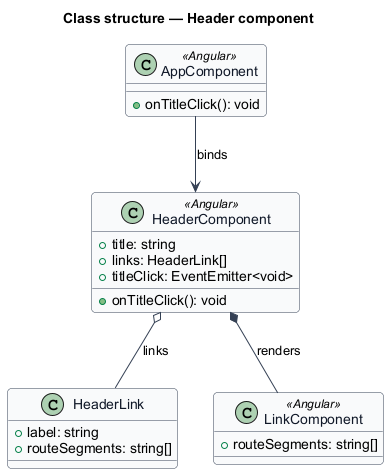
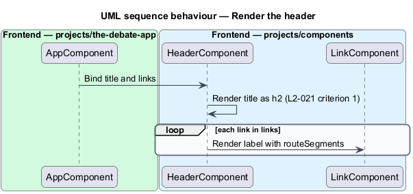
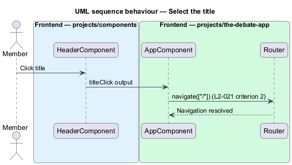

# Header component

## Overview

The Debate App shows one header on every page. The header names the application and offers the primary navigation links. This feature covers the reusable header component.

**title** — heading text that names the application

**header link** — pair of a label and route segments that the header renders as a link

The header renders the title as a heading and one link per header link. Selecting the title navigates to the home route. The shell supplies the title and the links, so the header holds no routing knowledge of its own.

## Description

The component lives in `frontend/projects/components/src/lib/header`. It is presentational and imports nothing from `projects/api` or any feature project.

- **`HeaderComponent`** — standalone component. Inputs: `title` (`string`) and `links` (`HeaderLink[]`). Output: `titleClick`. The title renders in an `h2`. Each link renders through `LinkComponent`.
- **`HeaderLink`** — interface with `label` and `routeSegments`.
- **`LinkComponent`** — renders each link and its active state (see the link design).
- **`AppComponent`** — in `projects/the-debate-app`. It supplies the inputs and handles `titleClick` by navigating to `/`, so the header needs no `Router`.

The legacy header rendered the heading `Architecture` and the links `MEETINGS` (`/meetings`), `CREATE` (`/meeting/create`) and `LOGIN` (`/login`). The mocks differ:

| Item | Legacy (L2-021) | Mocks (`pages/meeting-edit`) | Decision |
|------|-----------------|------------------------------|----------|
| Title | `Architecture` | `The Debate App` | `<TO SUPPLY>` |
| Link labels | `MEETINGS`, `CREATE`, `LOGIN` | `Meetings`, `New meeting` | `<TO SUPPLY>` |
| Login entry | `LOGIN` link | account menu avatar | `<TO SUPPLY>` |
| Create route | `/meeting/create` | mock page `meeting-create` | `<TO SUPPLY>` |

Because the title and links are inputs, either choice changes configuration in the shell and leaves the component unchanged. Heading level, brand icon and the account menu slot are `<TO SUPPLY>`.

## Requirements

| L2 ID | Refines (L1) | Requirement |
|-------|--------------|-------------|
| `L2-021` | `L1-010`, `L1-013` | `ce-header` renders in a shadow root with the heading `Architecture` and three links. 1. Given the header renders, when inspected, then it shows an `h2` with text `Architecture` and links labelled `MEETINGS` (to `/meetings`), `CREATE` (to `/meeting/create`), and `LOGIN` (to `/login`). 2. Given the `h2` is clicked, when the handler runs, then the router navigates to `/`. |

## Diagrams

### System context

A member sees the header on every page. The feature has no external dependency.

### Containers

The header runs inside the Angular web client only.

### Components

`AppComponent` binds the title and links of `HeaderComponent`, which renders `LinkComponent` instances and raises `titleClick`.

### Class structure

`HeaderComponent` owns a list of `HeaderLink` values and composes `LinkComponent`.

### Behaviour — render the header

The header renders the title in an `h2` and one link per entry (L2-021 criterion 1).

### Behaviour — select the title

The title click reaches the shell through `titleClick`, and the shell navigates to `/` (L2-021 criterion 2).

