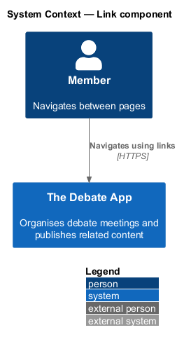
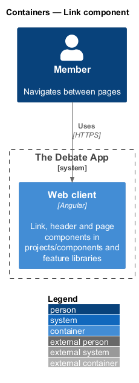
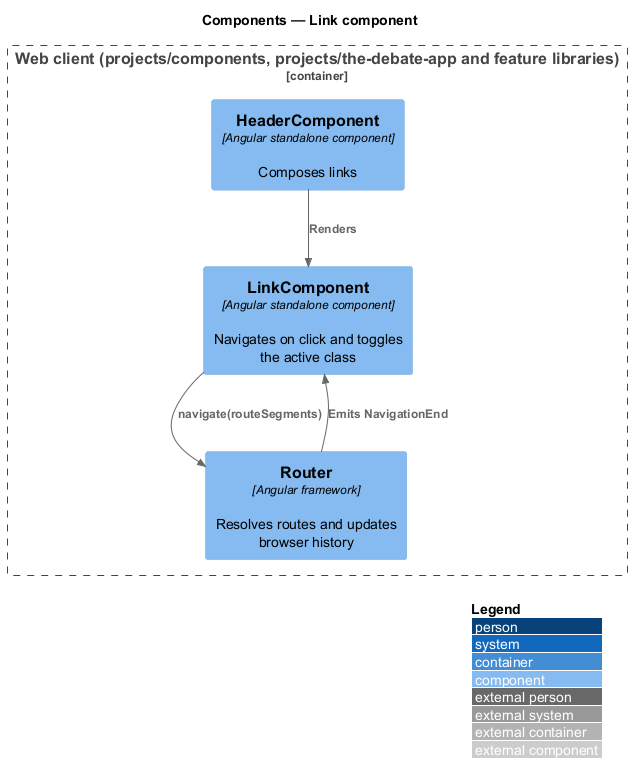
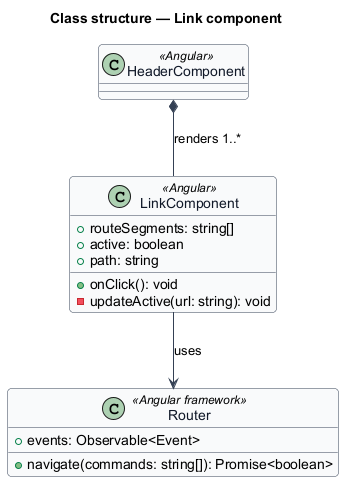
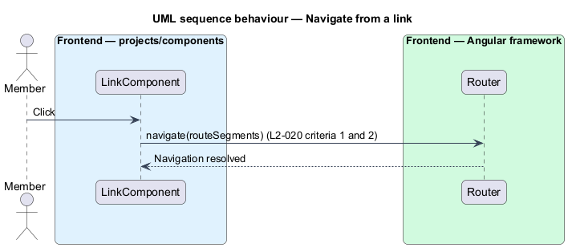
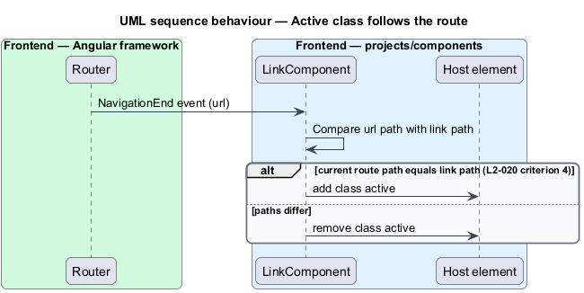

# Link component

## Overview

The Debate App is a single-page application. Every in-app navigation target is a link that changes the client route without a page load. This feature covers the reusable link component and its active state.

**active link** — link whose path equals the current route path

**route segments** — ordered list of path parts that a link resolves to a client route

A member selects a link. The link navigates to the path built from its route segments. The link carries the class `active` while the current route path equals its own path, so the navigation shows the current page.

## Description

The component lives in `frontend/projects/components/src/lib/link`. It is presentational: it takes inputs, raises navigation through the Angular `Router`, and imports nothing from `projects/api` or any feature project. The public surface is exported through `projects/components/src/public-api.ts`.

- **`LinkComponent`** — standalone component. It renders its projected content inside an anchor. The input `routeSegments` (`string[]`) holds the segments. A click navigates to the joined path. The host sets `cursor: pointer`.
- **Active state** — the component subscribes to router navigation events, compares the current URL path with its own path, and toggles the host class `active`. In the mocks the same state appears as `aria-current="page"` on `.nav-link`. The link should also set `aria-current="page"` while `active`. The visual mapping between `active` and `.nav-link[aria-current]` is `<TO SUPPLY>`.
- **Router dependency** — the legacy router was a custom class. The Angular `Router` replaces it, which also keeps browser history in sync (L1-010).

Behaviour is in two sequences. The first covers a click. The second covers a route change after which each link in the page recomputes `active`.

Open points: the selector prefix for components is `<TO SUPPLY>`. The legacy element was `ce-link` with the attribute `routesegments` holding a JSON array; the Angular input replaces the attribute.

## Requirements

| L2 ID | Refines (L1) | Requirement |
|-------|--------------|-------------|
| `L2-020` | `L1-010`, `L1-013` | `ce-link` navigates via the `routesegments` attribute. 1. Given `<ce-link routesegments='["meetings"]'>`, when it is clicked, then the router navigates to `/meetings`. 2. Given `<ce-link routesegments='["meeting","create"]'>`, when it is clicked, then the router navigates to `/meeting/create`. 3. Given a `ce-link` is connected, when rendered, then its cursor style is `pointer`. 4. Given the current route path equals the link's path, when the route changes, then the link has class `active`; otherwise `active` is removed. |

## Diagrams

### System context

A member navigates The Debate App through links. The feature has no external dependency.

### Containers

The link runs inside the Angular web client only.

### Components

`LinkComponent` calls the Angular `Router` and listens to its navigation events. The header and feature pages render links.

### Class structure

`LinkComponent` holds `routeSegments` and the derived `active` flag. `HeaderComponent` composes links.

### Behaviour — navigate from a link

A click calls `Router.navigate` with the segments, so `["meetings"]` resolves to `/meetings` and `["meeting","create"]` to `/meeting/create` (L2-020 criteria 1 and 2).

### Behaviour — active class follows the route

After each navigation the link compares the route path with its own path and adds or removes `active` (L2-020 criterion 4).

