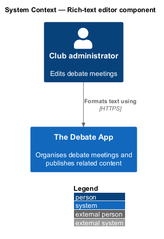
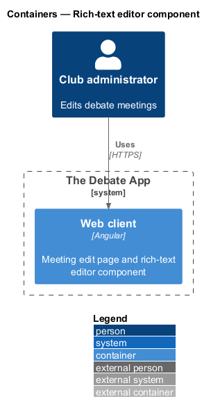
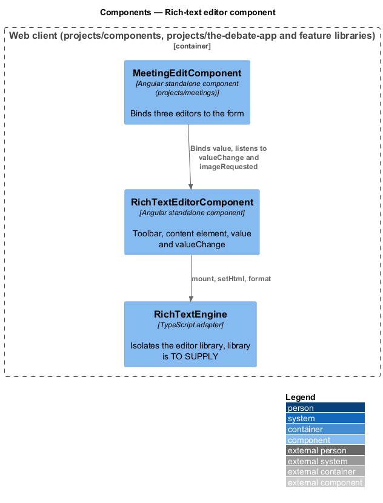
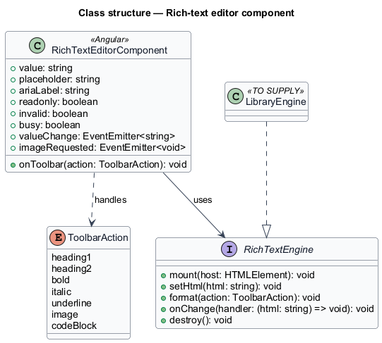
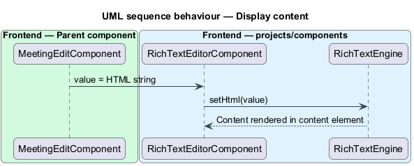
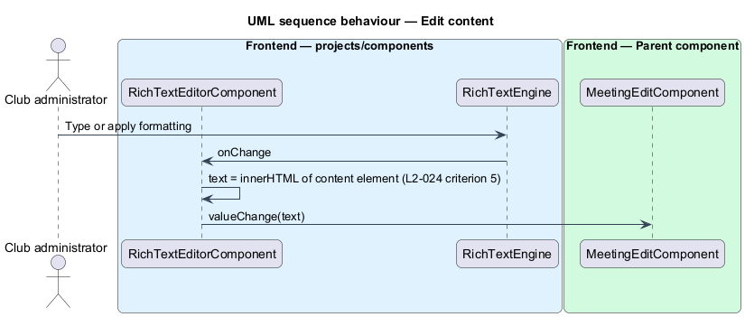
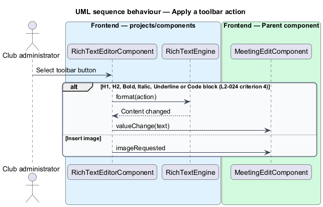

# Rich-text editor component

## Overview

The meeting create and edit pages hold three rich-text fields: abstract, agenda and minutes. Each field uses the same editor. This feature covers the reusable editor wrapper and the two acceptance criteria of L2-024 that define it.

**editor wrapper** — presentational component that hosts a rich-text editor library and exposes its content as HTML

**content element** — element that holds the editable content of the editor

L2-024 also defines the meeting form, the date pickers, Save and Delete. Those parts belong to the save-meeting design and to the meeting edit page. This design covers criteria 4 and 5 only.

The mocks `pages/meeting-edit` and `pages/meeting-create` define the visuals: a bordered `.editor` with a toolbar (`.editor__toolbar`) and an editable region (`.editor__content`, `role="textbox"`, `aria-multiline="true"`). The toolbar shows the buttons Heading 1, Heading 2, Bold, Italic, Underline, Insert image and Code block, with `aria-pressed` for the active format. The states in the mocks are default, hover, focus, invalid (`aria-invalid="true"`), read-only (`.editor--readonly`) and busy (`.editor--busy`). The placeholder shows through `data-placeholder` when the content is empty.

## Description

The component lives in `frontend/projects/components/src/lib/rich-text-editor`. It is presentational: inputs and outputs only, no HTTP call, and no import from `projects/api` or any feature project. The editor content leaves the component as an HTML string.

- **`RichTextEditorComponent`** — standalone component. Inputs: `value` (HTML `string`), `placeholder`, `ariaLabel`, `readonly`, `invalid`, `busy`. Outputs: `valueChange` (HTML `string`) and `imageRequested`.
- **Toolbar (criterion 4)** — header levels 1 and 2, bold, italic, underline, image and code block. The legacy editor used the Quill `snow` theme.
- **Content (criterion 5)** — after a text change the `text` value equals the inner HTML of the content element. The component emits that value through `valueChange`.
- **Library adapter** — `RichTextEngine` isolates the editor library behind `mount`, `setHtml`, `format`, `onChange` and `destroy`. The component calls the adapter only. A library replacement changes the adapter and leaves the component inputs and outputs unchanged.
- **Image button** — the button raises `imageRequested`. The dialog with the file drop zone and the upload to `/api/digitalasset/upload` (L2-011) are deferred.
- **Pages** — `MeetingEditComponent` uses three instances inside the tab strip and binds `value` and `valueChange` to its form. An instance in a hidden panel should keep its content.

Open points:

| Point | Status |
|-------|--------|
| Editor library | `<TO SUPPLY>` (legacy: Quill with `snow` theme) |
| HTML sanitisation of pasted and loaded content | `<TO SUPPLY>` |
| Toolbar keyboard model | `<TO SUPPLY>` |
| Embedding of images (data URI or uploaded asset) | `<TO SUPPLY>` |

## Requirements

| L2 ID | Refines (L1) | Requirement |
|-------|--------------|-------------|
| `L2-024` | `L1-011` | `ce-meeting-edit` renders a form with Date, Start, End, Name, Abstract, Agenda, Minutes, Save, and Delete. This design covers criteria 4 and 5. 4. Given Abstract, Agenda, and Minutes, when they render, then each is a Quill editor with the `snow` theme and a toolbar offering header levels 1 and 2, bold, italic, underline, image, and code block. 5. Given a Quill editor's text changes, when read, then the editor's `text` property equals the inner HTML of its content element. |

The wrapper also answers `L1-013`, which lists the rich-text editor wrapper among the reusable components.

## Diagrams

### System context

A club administrator formats the abstract, agenda and minutes of a meeting. The feature has no external dependency.

### Containers

The editor runs inside the Angular web client only.

### Components

`MeetingEditComponent` binds `RichTextEditorComponent`, which drives the editor library through `RichTextEngine`.

### Class structure

`RichTextEditorComponent` depends on the `RichTextEngine` abstraction. `<TO SUPPLY>` names the concrete library adapter.

### Behaviour — display content

A bound HTML string is set into the editor through the engine.

### Behaviour — edit content

A text change sets `text` to the inner HTML of the content element and emits it (L2-024 criterion 5).

### Behaviour — apply a toolbar action

Toolbar buttons apply the formats of L2-024 criterion 4. The image button raises `imageRequested`.

