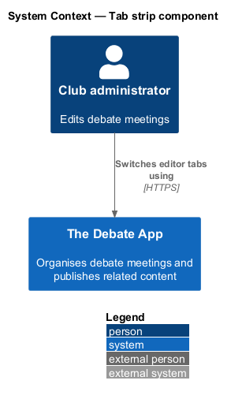
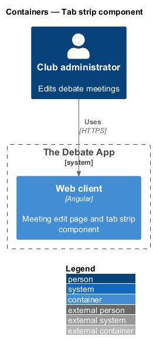
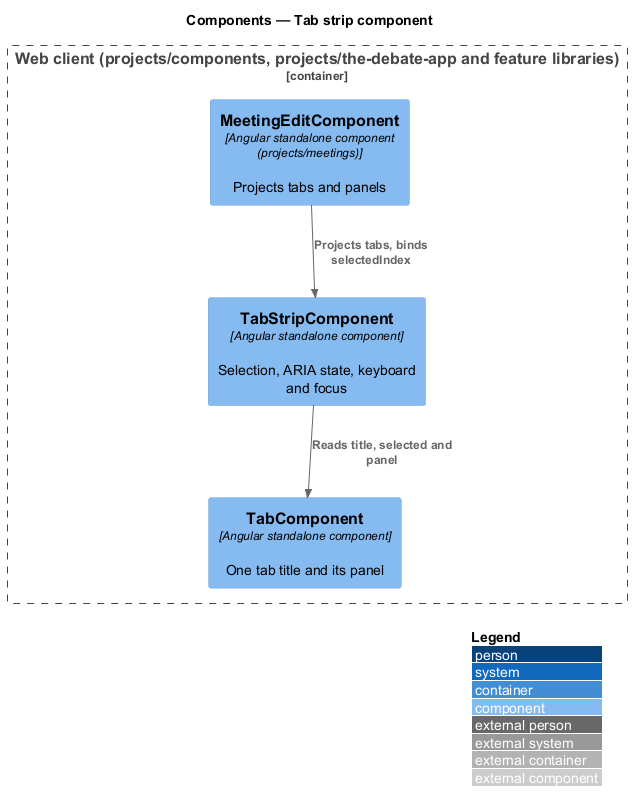
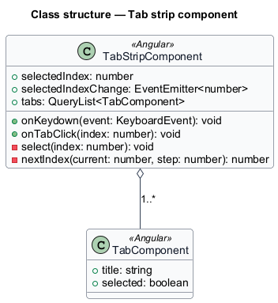
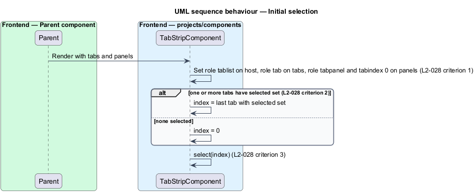
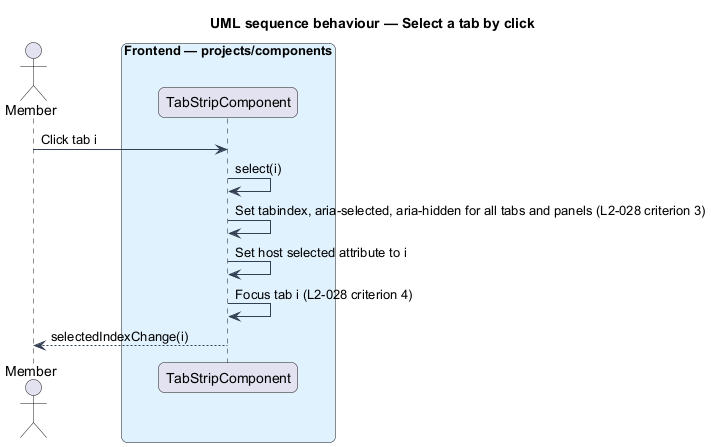
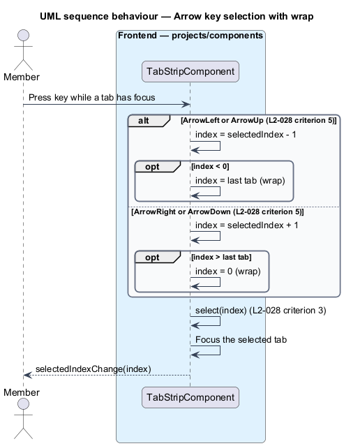

# Tab strip component

## Overview

The meeting create and edit pages hold three long rich-text fields: abstract, agenda and minutes. A tab strip shows one field at a time. This feature covers the reusable tab strip.

**tab** — selectable title of one panel

**panel** — content region that a tab shows when selected

**selected index** — zero-based position of the tab whose panel is visible

The mocks `pages/meeting-edit` and `pages/meeting-create` define the visible form: a pill-shaped `.tabs__list` with the tabs `Abstract`, `Agenda` and `Minutes`, and one `.tabs__panel` visible at a time. The selected tab has a raised surface. Keyboard focus shows a focus ring.

## Description

The component lives in `frontend/projects/components/src/lib/tab-strip`. It is presentational and imports nothing from `projects/api` or any feature project.

- **`TabStripComponent`** — standalone component. It reads its `TabComponent` children through content projection. Input: `selectedIndex` (`number`, optional). Output: `selectedIndexChange`. The host has `role="tablist"` and carries the attribute `selected` equal to the selected index.
- **`TabComponent`** — standalone component. Inputs: `title` (`string`), `selected` (`boolean`). It projects the panel content, which has `role="tabpanel"` and `tabindex="0"`.
- **Selection** — the strip selects the last tab with `selected` set, otherwise the first tab. The selected tab has `tabindex="0"` and `aria-selected="true"`. Every other tab has `tabindex="-1"` and `aria-selected="false"`. The selected panel has `aria-hidden="false"`. Every other panel has `aria-hidden="true"`.
- **Keyboard** — ArrowLeft and ArrowUp select the previous tab and wrap from the first to the last. ArrowRight and ArrowDown select the next tab and wrap from the last to the first. The newly selected tab receives focus.
- **Pointer** — a click on a tab title selects it and gives it focus.
- **Styling** — the classes `.tabs`, `.tabs__list`, `.tabs__tab` and `.tabs__panel` from `docs/mocks/assets/ui.css` define the visuals. The mocks pair each tab with its panel through `aria-controls` and `aria-labelledby`. The strip should set both.

Home, End and Delete keys, and automatic versus manual activation on arrow focus, are not in L2-028. They are `<TO SUPPLY>`. The legacy element used slots (`slot="title"`); content projection replaces them. The selector prefix is `<TO SUPPLY>`.

## Requirements

| L2 ID | Refines (L1) | Requirement |
|-------|--------------|-------------|
| `L2-028` | `L1-013` | `ce-fancy-tabs` is a shadow-DOM tab strip with `title`-slotted tabs and default-slotted panels. 1. Given children with `slot="title"` and panel elements, when connected, then the host has `role="tablist"`, each tab has `role="tab"`, and each panel has `role="tabpanel"` and `tabindex="0"`. 2. Given one or more tabs carry a `selected` attribute, when connected, then the last such tab is selected; otherwise the first tab is selected. 3. Given tab index `i` is selected, when applied, then that tab has `tabindex="0"` and `aria-selected="true"`, every other tab has `tabindex="-1"` and `aria-selected="false"`, panel `i` has `aria-hidden="false"`, every other panel has `aria-hidden="true"`, and the host's `selected` attribute equals `i`. 4. Given a tab is clicked, when the click target is a `slot="title"` element, then it becomes selected and receives focus. 5. Given focus is in the tab slot, when ArrowLeft or ArrowUp is pressed, then the previous tab is selected (wrapping from first to last); when ArrowRight or ArrowDown is pressed, then the next tab is selected (wrapping from last to first). |

## Diagrams

### System context

A club administrator switches between editor fields on the meeting pages. The feature has no external dependency.

### Containers

The tab strip runs inside the Angular web client only.

### Components

`MeetingEditComponent` projects tabs and panels into `TabStripComponent`, which manages selection, ARIA state and focus.

### Class structure

`TabStripComponent` owns its `TabComponent` children and the selected index.

### Behaviour — initial selection

On connection the strip applies roles and selects the last tab with `selected`, otherwise the first (L2-028 criteria 1 to 3).

### Behaviour — select a tab by click

A click selects the tab, updates ARIA state and the host `selected` attribute, and moves focus (L2-028 criteria 3 and 4).

### Behaviour — arrow key selection with wrap

Arrow keys move the selection by one tab and wrap at both ends (L2-028 criterion 5).

